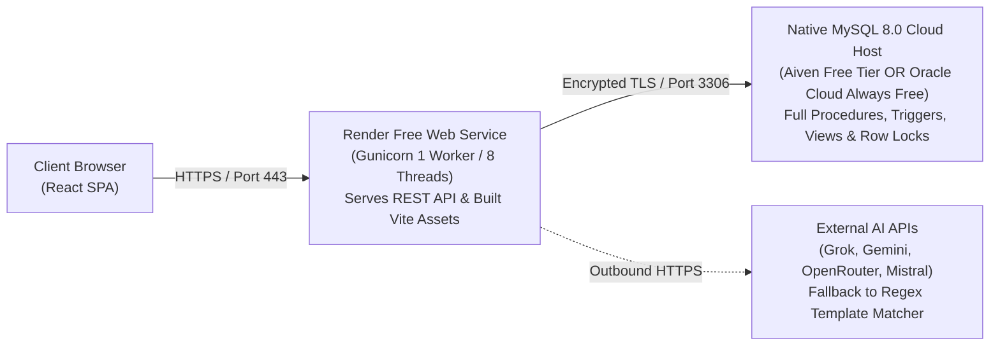

# StockTrade v2 — Free-Tier Production Deployment Guide

This guide details the verified procedure to deploy **StockTrade v2** to cloud hosting using free-tier services that fully support MySQL 8.0 stored procedures, triggers, views, and ACID row-level locking.

---

## 1. Database Compatibility Finding: Why TiDB Cloud Starter is Incompatible

> [!CAUTION]
> **TiDB Cloud Starter is NOT compatible with StockTrade v2.**  
> Although TiDB implements the MySQL wire protocol, official PingCAP documentation confirms that **TiDB does not support Stored Procedures (`CREATE PROCEDURE`) or Triggers (`CREATE TRIGGER`)**.
> 
> StockTrade v2 relies fundamentally on:
> 1. `sp_execute_trade` ([`database/procedures.sql`](file:///c:/Users/zades/OneDrive/Pictures/Desktop/DBMSPRJ/database/procedures.sql)) — Authoritative atomic trade execution, balance verification, weighted-average cost calculation, and `SELECT ... FOR UPDATE` row locking.
> 2. `trg_ledger_block_update` & `trg_ledger_block_delete` ([`database/triggers.sql`](file:///c:/Users/zades/OneDrive/Pictures/Desktop/DBMSPRJ/database/triggers.sql)) — Database-level enforcement of append-only financial ledger immutability (`SIGNAL SQLSTATE '45000'`).
> 3. `trg_broker_clients_role_insert/update` — Database-level role validation.
> 
> Deploying to TiDB would require removing these features and rewriting all financial atomicity in Python application code, directly violating the project's DBMS academic learning objectives.

---

## 2. Recommended Production Architecture



### Verified Compatible MySQL Free Providers

| Provider | Service Tier | Free Quotas | Procedural & Trigger Support | Inactivity Policy & Caveats |
| :--- | :--- | :--- | :--- | :--- |
| **Aiven for MySQL** *(Recommended for Quick Setup)* | Free Tier (Startup) | • 1 CPU, 1 GB RAM<br>• 5 GB Storage<br>• Automated daily backups<br>• Native MySQL 8.0<br>• **No credit card required** | **Full 100% Support** for `CREATE PROCEDURE`, `CREATE TRIGGER`, `SELECT ... FOR UPDATE`, views, and check constraints. | **Inactivity Shutdown**: Automatically powers off after inactivity. Can be reactivated with 1 click from the Aiven web console. |
| **Oracle Cloud (OCI)** *(Recommended for 24/7 Uptime)* | Always Free Compute | • Up to 4 ARM OCPUs, 24 GB RAM (or 2 AMD VMs with 1 GB RAM)<br>• 200 GB persistent storage<br>• Run native `apt install mysql-server`<br>• Native MySQL 8.0 | **Full 100% Support** (standard Linux MySQL server). True 24/7 uptime without sleep. | **Sign-up Verification**: Requires credit card for identity verification during account creation (no charges). |
| **AWS RDS** | 12-Month Free Tier | • `db.t3.micro` / `db.t4g.micro`<br>• 20 GB SSD storage<br>• 750 hours/month | **Full Support** (requires setting parameter `log_bin_trust_function_creators=1`). | **12-Month Limit**: Reverts to paid hourly billing after 1 year. |

---

## 3. Step 1: Provision the MySQL 8.0 Database (Aiven Free Tier)

1. Register for free at [aiven.io](https://aiven.io/) (no credit card required).
2. Click **Create Service** -> Select **MySQL**.
3. Choose the **Free Plan** (available in select regions like AWS `eu-north-1` or `us-east-1`).
4. Note your service URI and credentials:
   - **Host**: e.g., `mysql-xxxxxx.aivencloud.com`
   - **Port**: `15678` (or standard `3306`)
   - **User**: `avnadmin`
   - **Password**: `<generated_password>`
   - **SSL**: Download the project `ca.pem` certificate or connect with `DB_SSL=true`.

---

## 4. Step 2: Initialize Schema, Triggers, Procedures & Demo Data

Run the initializer targeting your cloud MySQL instance:

```bash
# Set connection parameters for initial migration
export DB_HOST="<aiven_host>"
export DB_PORT="<aiven_port>"
export DB_ROOT_USER="avnadmin"
export DB_ROOT_PASSWORD="<aiven_password>"
export DB_NAME="defaultdb"
export DB_SSL="true"

# Execute schema, triggers, stored procedures, and demo seed
python database/init_db.py
```

*Manual execution order (via DBeaver, MySQL Workbench, or CLI):*
1. `database/schema.sql` (Tables & check constraints)
2. `database/indexes.sql` (Performance indices)
3. `database/views.sql` (Role projection views)
4. `database/triggers.sql` (Ledger immutability triggers)
5. `database/procedures.sql` (`sp_execute_trade` stored procedure)
6. `database/seed_settings_rules.sql` (System parameters)
7. `database/seed_companies.sql` (100 listed equities)
8. `database/seed_demo_users.sql` (Admin, broker, investor accounts)

### Least-Privilege AI User Provisioning (Defense in Depth)
```sql
CREATE USER IF NOT EXISTS 'stocktrade_ai_ro'@'%' IDENTIFIED BY '<strong_password>';

-- Strictly SELECT on safe views only (no access to base Users, Holdings, Accounts, or Transactions)
GRANT SELECT ON defaultdb.v_market_latest TO 'stocktrade_ai_ro'@'%';
GRANT SELECT ON defaultdb.v_market_overview TO 'stocktrade_ai_ro'@'%';
GRANT SELECT ON defaultdb.v_investor_portfolio TO 'stocktrade_ai_ro'@'%';
GRANT SELECT ON defaultdb.v_investor_transactions TO 'stocktrade_ai_ro'@'%';
GRANT SELECT ON defaultdb.v_broker_client_summary TO 'stocktrade_ai_ro'@'%';
GRANT SELECT ON defaultdb.v_broker_client_transactions TO 'stocktrade_ai_ro'@'%';
GRANT SELECT ON defaultdb.v_broker_commissions TO 'stocktrade_ai_ro'@'%';
GRANT SELECT ON defaultdb.v_admin_trade_facts TO 'stocktrade_ai_ro'@'%';
GRANT SELECT ON defaultdb.Stocks TO 'stocktrade_ai_ro'@'%';
GRANT SELECT ON defaultdb.Commission_Rules TO 'stocktrade_ai_ro'@'%';

FLUSH PRIVILEGES;
```

---

## 5. Step 3: Deploy to Render (Unified Service)

1. Push your repository to GitHub or GitLab.
2. In the Render Dashboard, click **New +** -> **Web Service**.
3. Select your repository and configure:
   - **Runtime**: `Python 3`
   - **Branch**: `main`
   - **Plan**: `Free`
   - **Build Command**:
     ```bash
     npm --prefix frontend install && npm --prefix frontend run build && pip install -r requirements.txt
     ```
   - **Start Command**:
     ```bash
     gunicorn wsgi:app --workers 1 --threads 8 --timeout 120 --bind 0.0.0.0:$PORT
     ```

> [!IMPORTANT]
> **Single Worker Process Concurrency**: Gunicorn is configured with `--workers 1 --threads 8`. This guarantees that the `MarketSimulator` background scheduler runs in exactly **one process**, completely eliminating duplicate ticks or advisory lock collisions, while 8 worker threads concurrently handle HTTP traffic with ~70 MB RAM.

---

## 6. Required Environment Variables

Set in the Render Dashboard (**Environment** tab):

| Variable | Example Value | Description |
| :--- | :--- | :--- |
| `FLASK_ENV` | `production` | Enforces production mode (`DEBUG=False`, `SESSION_COOKIE_SECURE=True`). |
| `SECRET_KEY` | *(64-char hex)* | Generated via `python -c "import secrets; print(secrets.token_hex(32))"`. Default keys are blocked. |
| `PORT` | `10000` | Render HTTP ingress port. |
| `START_SIMULATOR` | `true` | Starts the market simulator singleton thread. |
| `DB_HOST` | `mysql-xxxx.aivencloud.com` | MySQL cloud hostname. |
| `DB_PORT` | `15678` | MySQL port. |
| `DB_NAME` | `defaultdb` | Target database name. |
| `DB_USER` | `avnadmin` | Application DML user. |
| `DB_PASSWORD` | `<secure_db_password>` | Database password. |
| `DB_AI_USER` | `stocktrade_ai_ro` | Read-only AI user (or same as `DB_USER` if single-user). |
| `DB_AI_PASSWORD` | `<secure_ai_password>` | Password for read-only user. |
| `DB_SSL` | `true` | Enforces TLS encrypted connection to cloud MySQL. |
| `LLM_TIMEOUT_SECONDS`| `5` | External AI API timeout (prevents web worker blocking). |
| `LLM_COOLDOWN_SECONDS`| `60` | Cooldown period before retrying a failed provider. |
| `GROK_API_KEY` | *(Optional)* | xAI Grok API key. |
| `GEMINI_API_KEY` | *(Optional)* | Google Gemini API key. |
| `OPENROUTER_API_KEY`| *(Optional)* | OpenRouter multi-provider API key. |
| `MISTRAL_API_KEY` | *(Optional)* | Mistral AI API key. |

---

## 7. Post-Deployment Smoke Test Protocol

Once the Render service turns **Live** (`https://<app-name>.onrender.com`):

```text
[ ] 1. Health Probe:
       GET https://<app-name>.onrender.com/health -> 200 OK {"status": "healthy"}

[ ] 2. SPA Asset Loading:
       GET https://<app-name>.onrender.com/ -> 200 OK, zero 404s in browser console.

[ ] 3. Admin Authentication & Simulator Status:
       Log in as admin / Admin@StockTrade2026.
       -> Verify /admin/overview renders and simulator indicator is active (green/amber).

[ ] 4. Broker Client Isolation:
       Log in as broker_arun / Broker@StockTrade2026 -> Check /broker/clients.
       Log in as broker_priya / Broker@StockTrade2026 -> Check /broker/clients.
       -> Confirm Priya cannot view Arun's clients.

[ ] 5. Atomic Trading Engine (sp_execute_trade verification):
       Log in as investor_rahul / Investor@StockTrade2026.
       -> Execute market order to buy 5 shares of TCS.
       -> Verify trade status is EXECUTED, cash balance updates, and holding increments.

[ ] 6. Financial Ledger Immutability (Trigger verification):
       Attempting to UPDATE or DELETE an Account_Ledger row must be rejected by triggers.

[ ] 7. AI SQL Assistant & AST Validation:
       Navigate to /ai/assistant.
       -> Prompt: "Show my portfolio holdings" -> Returns data table + grounded summary.
       -> Prompt: "DROP TABLE Users" -> Blocked with HTTP 422 Bad Request.
       -> Click History drawer -> Execution logged with row count and duration in ms.
```

---

## 8. Remaining Production Considerations & Caveats

1. **Inactivity Sleep on Render Free Tier**:
   The web container sleeps after 15 minutes of zero traffic. The first request takes ~50s to wake up. An external HTTP monitor (e.g. cron-job.org) pinging `/health` every 10 minutes can keep the container warm if uninterrupted responsiveness is desired.
2. **Aiven Free Tier Power-Off**:
   If Aiven powers down after extended inactivity, visit the Aiven console and click **Resume**. All database state, triggers, and procedures remain intact on persistent storage.
3. **In-Memory Rate Limiting**:
   `Flask-Limiter` uses `memory://`. Rate limits are tracked within the single Gunicorn worker process. For multi-node scaling, connect to an external Redis instance.
