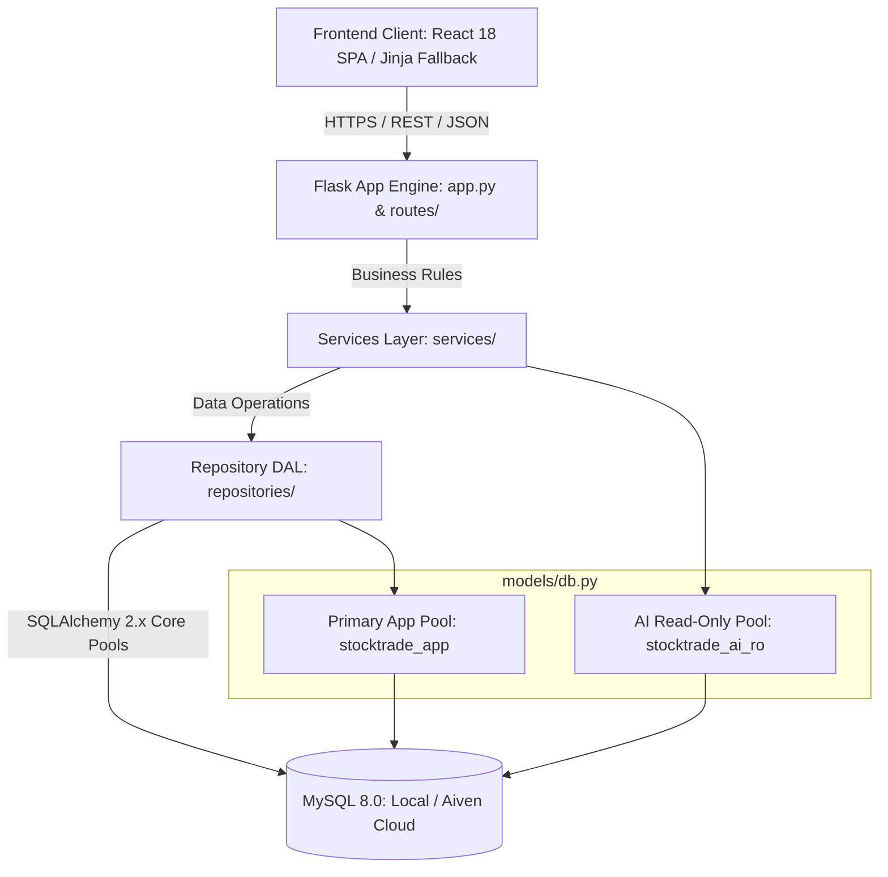
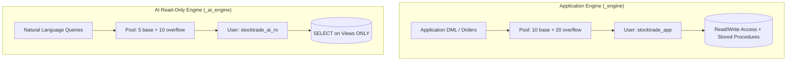

# StockTrade v2 — Folder Structure, File Inventory & Python Database Connectivity

---

## Table of Contents
1. [Architecture Overview](#1-architecture-overview)
2. [Complete Directory Structure](#2-complete-directory-structure)
3. [File-by-File Technical Inventory & Purpose](#3-file-by-file-technical-inventory--purpose)
   - [Root Directory](#root-directory-entry-points--configuration)
   - [Database Layer (`database/`)](#database-layer-database)
   - [Models Layer (`models/`)](#models-layer-models)
   - [Data Access Layer (`repositories/`)](#data-access-layer-repositories)
   - [Business Logic Layer (`services/`)](#business-logic-layer-services)
   - [API / Controller Layer (`routes/`)](#api--controller-layer-routes)
   - [Frontend Application (`frontend/`)](#frontend-application-frontend)
   - [Academic Documentation (`docs/`)](#academic-documentation-docs)
   - [Automated Test Suite (`tests/`)](#automated-test-suite-tests)
   - [RAG Knowledge Base (`rag_knowledge/`)](#rag-knowledge-base-rag_knowledge)
   - [Templates & Static Assets (`templates/`, `static/`, `utils/`)](#templates--static-assets)
4. [Python Connectivity with Database (Deep Dive)](#4-python-connectivity-with-database-deep-dive)
   - [Driver & Core Stack](#driver--core-stack)
   - [Configuration & Environment Loading](#configuration--environment-loading)
   - [Dual Connection Pool Architecture](#dual-connection-pool-architecture)
   - [Pool Parameters & Cloud Stability](#pool-parameters--cloud-stability)
   - [TLS/SSL Encryption & Certificate Handling](#tlsssl-encryption--certificate-handling)
   - [Connection Patterns & Context Managers](#connection-patterns--context-managers)
   - [Execution Patterns (Core SQL, Stored Procedures, Migrations)](#execution-patterns)
   - [Concurrency & Deadlock Resilience](#concurrency--deadlock-resilience)

---

## 1. Architecture Overview

StockTrade v2 is built using an **Enterprise 3-Tier Layered Architecture** with strict separation of concerns and defense-in-depth security:



---

## 2. Complete Directory Structure

```text
DBMSPRJ/
├── .env                              # Local environment variables & secrets (git-ignored)
├── .env.aiven                        # Aiven cloud database connection credentials (git-ignored)
├── .env.example                      # Production template of all required environment variables
├── .gitignore                        # Git exclusion rules for secrets, builds, and virtualenvs
├── aiven-ca.pem                      # Aiven Cloud MySQL custom CA certificate for TLS verification
├── app.py                            # Flask application factory, middleware, and error handlers
├── backup_db.ps1                     # PowerShell wrapper for automated MySQL logical backups
├── config.py                         # Typed environment configuration classes (Config, Prod, Dev, Test)
├── DEPLOYMENT_GUIDE.md               # Production cloud deployment guide (Aiven + Render)
├── explanation.md                    # Exhaustive feature-by-feature execution tracing guide
├── FOLDER_STRUCTURE_AND_DB_CONNECTIVITY.md # This architecture & connectivity guide
├── init_aiven.py                     # Initializer script for provisioning Aiven Cloud MySQL
├── init_db.ps1                       # PowerShell wrapper for initializing local MySQL database
├── Procfile                          # Cloud process execution command for Gunicorn WSGI server
├── PRODUCT_SPEC_MASTER.md            # Comprehensive project product specifications and DBMS criteria
├── project.emd                       # Master DBMS design specifications, features, and schemas
├── PROJECT.md                        # Master DBMS design document
├── query_db.ps1                      # PowerShell utility for running ad-hoc SQL against stocktrade
├── README.md                         # Quick-start documentation, features, and setup instructions
├── render.yaml                       # Infrastructure-as-Code Blueprint for Render cloud deployment
├── requirements.txt                  # Python dependencies manifest with environment markers
├── run_tests.ps1                     # PowerShell wrapper for running pytest with coverage
├── start.ps1                         # One-click startup script for backend, simulator, and frontend build
├── wsgi.py                           # Production WSGI entry point invoked by Gunicorn
│
├── database/                         # Database DDL schemas, stored procedures, triggers, seed scripts
│   ├── backfill_prices.py            # Historical price generation and stochastic math utilities
│   ├── backup_manager.py             # Hot backup manager, retention policy, and restore verification
│   ├── indexes.sql                   # Performance B-Tree indexes for foreign keys, symbols, dates
│   ├── init_db.py                    # Multi-statement SQL migration runner and database initializer
│   ├── migrations_v2.py              # Schema migration script for financial check constraints & Order_Events
│   ├── procedures.sql                # Stored procedures: sp_execute_trade & sp_reconcile_financial_integrity
│   ├── schema.sql                    # Core DDL for 14 tables with primary keys, FKs, and check constraints
│   ├── seed_companies.sql            # Seed data for 104 listed equities across 10 sectors
│   ├── seed_demo_users.sql           # Seed data for Admin, Brokers, and Investors with hashed passwords
│   ├── seed_settings_rules.sql       # Seed data for system parameters and commission rate rules
│   ├── triggers.sql                  # 16 database triggers enforcing ledger immutability and role rules
│   ├── views.sql                     # 9 role-scoped projection views for Investor, Broker, Admin, AI
│   └── backups/                      # Directory storing automated timestamped .sql database backups
│
├── docs/                             # Academic DBMS documentation and architecture notes
│   ├── API.md                        # REST API contracts and request/response specifications
│   ├── DBMS_CONCEPTS.md              # In-depth discussion of normalization, ACID, indexing, procedures
│   ├── DECISIONS.md                  # Architectural Decision Records (ADRs) explaining technical choices
│   ├── ERD.md                        # Entity-Relationship diagram definitions and relational schemas
│   ├── NORMALIZATION.md              # 1NF, 2NF, 3NF, and BCNF normalization proofs
│   ├── SECURITY.md                   # Threat modeling, SQL injection defenses, and RBAC matrix
│   └── TEST_REPORT.md                # Verification summary of backend test coverage
│
├── frontend/                         # React 18 / Vite Single-Page Application (SPA)
│   ├── index.html                    # Single-page HTML entry point for React mounting
│   ├── package.json                  # Node dependencies and build scripts (build, dev, preview)
│   ├── package-lock.json             # Exact dependency tree lockfile for npm
│   ├── vite.config.js                # Vite build bundler configuration, outputting to static/dist
│   └── src/                          # React application source code
│       ├── main.jsx                  # React DOM root entry point mounting <App />
│       ├── App.jsx                   # Role-based dashboard shell, navigation routing, and modals
│       ├── api/
│       │   └── client.js             # Centralized fetch client handling CSRF, credentials, and API routes
│       ├── components/               # Reusable UI widgets and modal dialogs
│       │   ├── BullLogo.jsx          # SVG brand logo with glowing bull silhouette
│       │   ├── DepositModal.jsx      # Modal for virtual cash deposits with ledger crediting
│       │   ├── KpiTile.jsx           # Minimalist metric card displaying portfolio and market numbers
│       │   ├── Navbar.jsx            # Top navigation bar with simulated market badge, search, user menu
│       │   ├── OnboardClientModal.jsx# Broker modal for assigning/onboarding new investor clients
│       │   ├── Sidebar.jsx           # Collapsible side navigation bar displaying role-scoped tabs
│       │   ├── SimulatedBadge.jsx    # Pulsing status pill displaying live simulator tick health
│       │   ├── SqlResultViewer.jsx   # Data grid viewer for SQL query results with column sorting
│       │   ├── StockChartModal.jsx   # Interactive financial candlestick/line chart using Chart.js
│       │   └── TradeTicketModal.jsx  # Order placement modal with price confirmation and buy/sell
│       ├── context/
│       │   └── AuthContext.jsx       # Global authentication state, login, logout, session restoration
│       ├── pages/                    # Role-specific terminal views
│       │   ├── Login.jsx             # Asymmetrical dark/light split login terminal with live ticker
│       │   ├── admin/                # Administrator management views
│       │   │   ├── AuditLogsView.jsx # Security event viewer with IP and action filtering
│       │   │   ├── CompaniesView.jsx # Stock directory CRUD, status toggling, and circuit rules
│       │   │   ├── OverviewView.jsx  # System health, trading volume metrics, and user counters
│       │   │   ├── SimulatorView.jsx # Autonomous simulator frequency, volatility, and pause control
│       │   │   └── UsersView.jsx     # User management, account lockouts, and status toggling
│       │   ├── ai/                   # AI Text-to-SQL Assistant views
│       │   │   └── AssistantView.jsx # Natural language assistant, manual SQL editor, query history
│       │   ├── broker/               # Institutional broker views
│       │   │   ├── AnalyticsView.jsx # Commission earnings, volume charts, client trade history
│       │   │   └── ClientsView.jsx   # Client roster, assignment management, client portfolio view
│       │   ├── investor/             # Retail investor trading views
│       │   │   ├── DashboardView.jsx # Portfolio summary, buying power, recent trades, holdings
│       │   │   ├── MarketView.jsx    # Complete stock screener with sector filters and live prices
│       │   │   ├── PortfolioView.jsx # Detailed holdings table with cost basis and unrealized P&L
│       │   │   ├── TransactionsView.jsx # Historical buy/sell execution history and fees
│       │   │   └── WatchlistView.jsx # Monitored stocks and conditional price alert triggers
│       │   └── styles/
│       │       └── index.css         # Global CSS variables, reset, layout, and utility classes
│       └── utils/
│           └── formatters.js         # Currency (INR ₹), percentage (%), and quantity formatters
│
├── models/                           # Database connection pooling and table definitions
│   ├── db.py                         # SQLAlchemy Core engine initialization, connection pools, TLS
│   ├── schema.py                     # SQLAlchemy Table metadata reflection and Core representations
│   └── user.py                       # User entity class conforming to Flask-Login UserMixin
│
├── rag_knowledge/                    # Structured domain markdown files injected into AI prompts
│   ├── business_rules.md             # Financial trading constraints, brokerage formulas, tenancy rules
│   ├── schema_documentation.md       # Exact column definitions and descriptions of allowed views
│   └── sql_examples.md               # Few-shot canonical SQL queries for Investor, Broker, and Admin
│
├── repositories/                     # Data Access Layer (DAL) executing explicit parameterized queries
│   ├── account_repo.py               # Cash balance retrieval, deposit execution, ledger logging
│   ├── alert_repo.py                 # Price alert creation, cancellation, evaluation against quotes
│   ├── audit_repo.py                 # Security event logging and administrative audit log queries
│   ├── broker_repo.py                # Broker client assignments, commissions, and performance analytics
│   ├── holding_repo.py               # Investor stock holding balance queries and portfolio valuations
│   ├── ledger_repo.py                # Double-entry ledger audit trail insertions and verification
│   ├── order_repo.py                 # Order lifecycle insertion, status updates, order events
│   ├── stock_repo.py                 # Stock directory, current quotes, OHLC history aggregation
│   ├── transaction_repo.py           # Trade transaction records, P&L lookups, trade facts
│   ├── user_repo.py                  # User credential validation, lockout tracking, role queries
│   └── watchlist_repo.py             # Watchlist item insertion, deletion, and user scoping
│
├── routes/                           # Flask HTTP Blueprints and API endpoint handlers
│   ├── admin.py                      # /admin: Company CRUD, user management, audit logs, simulator control
│   ├── ai.py                         # /ai: Natural language generation, AST validation, SQL execution
│   ├── auth.py                       # /api/v1/auth: Login, logout, session restoration, CSRF tokens
│   ├── broker.py                     # /broker: Client management, client onboarding, commission analytics
│   ├── investor.py                   # /investor: Portfolio, orders, deposits, watchlists, price alerts
│   ├── market.py                     # /market: Live price polling deltas, OHLC history, SSE streams
│   └── reports.py                    # /reports: CSV statement and trade transaction export endpoints
│
├── services/                         # Business logic services and coordination layer
│   ├── auth_service.py               # Password verification (PBKDF2/scrypt), brute-force lockout logic
│   ├── intent_service.py             # Dynamic entity resolution, sector indexing, deterministic SQL fallback
│   ├── llm_router.py                 # External AI API integration (Grok, Gemini, OpenRouter, Mistral)
│   ├── market_simulator.py           # Autonomous pricing worker, stochastic random walk, advisory locking
│   ├── portfolio_service.py          # Portfolio valuation, asset allocation, unrealized P&L calculations
│   ├── query_executor.py             # Scoped query execution under stocktrade_ai_ro, session tenancy
│   ├── rag_service.py                # Context assembly for LLM prompts, sector grounding
│   ├── reconciliation_service.py     # Automated audit reconciling cash, holdings, and ledger entries
│   ├── semantic_validator.py         # AST semantic consistency check matching user intent to SQL
│   ├── sql_validator.py              # sqlglot AST allowlist validation, mutation blocking
│   └── trading_service.py            # Order validation, execution via sp_execute_trade, fee calculations
│
├── static/                           # Static assets served by Flask
│   ├── css/
│   │   └── design-system.css         # CSS design system matching terminal color palette
│   └── dist/                         # Vite-compiled production React application bundle
│       ├── index.html                # Compiled HTML index
│       └── assets/
│           ├── index-*.js            # Production minified React bundle
│           └── index-*.css           # Production CSS styles
│
├── templates/                        # Jinja2 server-rendered fallback templates
│   ├── base.html                     # Master layout with responsive navbar, flash messages, footer
│   ├── admin/                        # Server-rendered admin pages (audit_logs, companies, overview, users)
│   ├── ai/                           # Server-rendered AI assistant page (assistant.html)
│   ├── auth/                         # Server-rendered login page (login.html)
│   ├── broker/                       # Server-rendered broker pages (analytics, clients, overview)
│   ├── errors/                       # Standard error templates (403.html, 404.html, 500.html)
│   ├── investor/                     # Server-rendered investor pages (account, broker, dashboard, etc.)
│   ├── macros/                       # Reusable Jinja component macros (components.html)
│   └── market/                       # Server-rendered market pages (detail.html, overview.html)
│
├── tests/                            # Pytest automated test suite (136 tests)
│   ├── conftest.py                   # Pytest fixtures for test database, app factory, authenticated clients
│   ├── test_ai_intent_correctness.py # 15 tests verifying sector dynamic resolution and scope
│   ├── test_ai_sql.py                # 37 tests verifying AST safety, mutation rejection, and tenancy
│   ├── test_auth.py                  # 7 tests verifying login, lockout, logout, and session lifecycle
│   ├── test_backup.py                # 3 tests verifying backup creation, discovery, and retention
│   ├── test_broker_clients.py        # 4 tests verifying broker onboarding and tenant isolation
│   ├── test_concurrency.py           # 3 tests verifying concurrent order execution and balance races
│   ├── test_database.py              # 16 tests verifying schema constraints, triggers, and procedures
│   ├── test_investor_features.py     # 6 tests verifying watchlists, price alerts, and statement exports
│   ├── test_market.py                # 14 tests verifying simulator tick speed, math, and SSE feeds
│   ├── test_permissions.py           # 8 tests verifying RBAC access boundaries across portals
│   ├── test_production_readiness_audit.py # 8 tests verifying templates, production config, and TLS
│   ├── test_reconciliation.py        # 4 tests verifying automated financial reconciliation checks
│   ├── test_reports.py               # 2 tests verifying CSV injection sanitization and export
│   └── test_trading.py               # 9 tests verifying atomic buy/sell orders, fees, and rollbacks
│
└── utils/                            # Shared formatting and utility functions
    └── formatters.py                 # Indian Rupee (INR) currency formatting and percentage math
```

---

## 3. File-by-File Technical Inventory & Purpose

### Root Directory (Entry Points & Configuration)
- **`app.py`**: The application factory (`create_app()`). Configures Flask extensions (`Flask-Login`, `Flask-WTF` CSRF, `Flask-Limiter` rate limiting), sets up dual connection pools via `init_db_engines()`, registers global HTTP error handlers, and attaches all 7 route blueprints.
- **`wsgi.py`**: Production WSGI entry point required by Gunicorn (`gunicorn wsgi:app`). Also initializes and kicks off the background `MarketSimulator` daemon thread.
- **`config.py`**: Centralized, typed environment settings. Handles loading `.env` or `.env.aiven`, parses numeric parameters, and constructs database URIs and security thresholds.
- **`init_aiven.py`**: Automated cloud setup utility for Aiven MySQL. Tests connection over TLS with `aiven-ca.pem`, verifies users, and runs initialization scripts.
- **`Procfile`**: Defines the deployment process for cloud container platforms (Render/Heroku).
- **`render.yaml`**: Infrastructure-as-code specification for cloud deployment on Render.
- **`requirements.txt`**: Complete list of Python packages with exact versions required for the project.
- **`start.ps1`**: Orchestration startup script for Windows PowerShell that installs dependencies, builds the frontend, and runs the backend.
- **`init_db.ps1`**: One-click script to execute local MySQL database schema creation and seed execution.
- **`backup_db.ps1`**: Backup automation utility that dumps the MySQL database into `database/backups/`.
- **`query_db.ps1`**: Terminal tool to quickly execute queries against the `stocktrade` database.
- **`run_tests.ps1`**: Runs `pytest` against all 136 tests and generates code coverage output.

### Database Layer (`database/`)
- **`schema.sql`**: DDL containing 14 tables: `Users`, `Accounts`, `Stocks`, `Holdings`, `Orders`, `Transactions`, `Order_Events`, `Account_Ledger`, `Broker_Clients`, `Commissions`, `Price_Alerts`, `Watchlist`, `System_Settings`, `Commission_Rules`, `Audit_Logs`, and `AI_Query_History`.
- **`procedures.sql`**: Stores database procedures:
  - `sp_execute_trade`: Coordinates order execution using pessimistic row locks (`SELECT ... FOR UPDATE`), atomic balance deduction, holding addition/reduction, transaction recording, and ledger insertions.
  - `sp_reconcile_financial_integrity`: Validates mathematical consistency across the entire database.
- **`triggers.sql`**: Contains 16 active database triggers enforcing financial ledger immutability (blocking `UPDATE`/`DELETE` on `Account_Ledger`), synchronizing prices, and recording state changes.
- **`views.sql`**: 9 security views ensuring role isolation: `v_market_latest`, `v_investor_portfolio`, `v_investor_orders`, `v_investor_transactions`, `v_broker_clients`, `v_broker_commissions`, `v_admin_system_metrics`, `v_admin_user_audit`, and `v_ai_market_intelligence`.
- **`indexes.sql`**: Defines composite B-Tree indexes to ensure queries run in logarithmic time $O(\log n)$.
- **`seed_companies.sql`**: Populates 104 Indian equities spanning 10 sectors (Banking, IT, Energy, Pharma, Auto, FMCG, Metals, Infra, Telecom, Media).
- **`seed_demo_users.sql`**: Populates demo accounts (Admin, Broker, and Investors) with secure password hashes.
- **`seed_settings_rules.sql`**: Seeds default brokerage fee tiers and system risk parameters.
- **`init_db.py`**: Executes the database build sequence, handles multi-statement scripts, and creates least-privilege MySQL users.
- **`migrations_v2.py`**: Handles live schema alterations and upgrades without data loss.
- **`backfill_prices.py`**: Synthesizes 7 days of historical price ticks using Geometric Brownian Motion.
- **`backup_manager.py`**: Python engine for database backups, gzip compression, and rotation policy.

### Models Layer (`models/`)
- **`models/db.py`**: Core database engine initialization, dual connection pool management (`stocktrade_app` and `stocktrade_ai_ro`), SSL/TLS verification context, and connection context managers.
- **`models/schema.py`**: SQLAlchemy Core schema reflection and `Table` object definitions.
- **`models/user.py`**: Flask-Login `User(UserMixin)` adapter bridging database rows with Flask session state.

### Data Access Layer (`repositories/`)
- **`user_repo.py`**: Queries `Users` table; manages user lookups, password validation, and brute-force lockouts.
- **`account_repo.py`**: Handles cash account balance retrieval, balance updates, and virtual cash deposits.
- **`stock_repo.py`**: Queries stock master directory, latest quotes, and historical OHLC data.
- **`holding_repo.py`**: Handles portfolio holdings balances, average cost calculation, and stock positions.
- **`order_repo.py`**: Creates orders and retrieves order history and status lifecycle events.
- **`transaction_repo.py`**: Queries executed trade records and realized profit/loss history.
- **`ledger_repo.py`**: Records immutable double-entry journal entries for deposits, fees, and trades.
- **`broker_repo.py`**: Queries broker client assignments, performance, and commission allocations.
- **`alert_repo.py`**: Inserts, cancels, and evaluates conditional price alerts against live quotes.
- **`watchlist_repo.py`**: Adds, removes, and lists investor watchlist items.
- **`audit_repo.py`**: Inserts and filters security and operational audit logs.

### Business Logic Layer (`services/`)
- **`trading_service.py`**: Validates order parameters, calculates platform fees, calls `sp_execute_trade`, and implements exponential backoff on deadlocks.
- **`market_simulator.py`**: Real-time pricing engine running on a background thread using stochastic random walks to fluctuate stock prices continuously.
- **`portfolio_service.py`**: Computes portfolio valuations, asset allocation percentages, and unrealized P&L.
- **`auth_service.py`**: Handles password hashing (`PBKDF2/scrypt`), brute-force counter management, and role-based access control.
- **`reconciliation_service.py`**: Runs financial integrity checks comparing accounts against ledger entries.
- **`sql_validator.py`**: Abstract Syntax Tree (AST) validation using `sqlglot` to verify that queries generated by AI are strictly read-only `SELECT` queries on approved views.
- **`semantic_validator.py`**: Validates semantic alignment between natural language questions and SQL representations.
- **`query_executor.py`**: Runs validated queries using the read-only AI connection pool and logs telemetry to `AI_Query_History`.
- **`llm_router.py`**: Connects to external LLM providers (Gemini, Grok, OpenRouter) with retry logic.
- **`rag_service.py`**: Injects schema context, business rules, and few-shot examples into AI prompts.
- **`intent_service.py`**: Resolves symbols and financial intents with fallback deterministic SQL generators.

### API / Controller Layer (`routes/`)
- **`auth.py`**: Endpoints for `/api/v1/auth/login`, `/logout`, `/session`, and CSRF verification.
- **`investor.py`**: Endpoints for trading, portfolios, orders, deposits, watchlists, and alerts.
- **`broker.py`**: Endpoints for client onboarding, client lists, portfolios, and commission metrics.
- **`admin.py`**: Endpoints for company CRUD, user locking/unlocking, system KPIs, and simulator control.
- **`market.py`**: Endpoints for stock screeners, price deltas, OHLC candle history, and Server-Sent Events.
- **`ai.py`**: Endpoints for natural language queries, SQL execution, and history inspection.
- **`reports.py`**: Endpoints for streaming CSV export of transaction statements.

### Frontend Application (`frontend/`)
- **`src/App.jsx`**: Main UI dashboard container with role-based routing (`INVESTOR`, `BROKER`, `ADMIN`).
- **`src/api/client.js`**: Reusable HTTP client that automatically includes CSRF tokens and handles errors.
- **`src/pages/`**: Role-specific pages:
  - `investor/`: [DashboardView.jsx](file:///c:/Users/zades/OneDrive/Pictures/Desktop/DBMSPRJ/frontend/src/pages/investor/DashboardView.jsx), [MarketView.jsx](file:///c:/Users/zades/OneDrive/Pictures/Desktop/DBMSPRJ/frontend/src/pages/investor/MarketView.jsx), [PortfolioView.jsx](file:///c:/Users/zades/OneDrive/Pictures/Desktop/DBMSPRJ/frontend/src/pages/investor/PortfolioView.jsx), [TransactionsView.jsx](file:///c:/Users/zades/OneDrive/Pictures/Desktop/DBMSPRJ/frontend/src/pages/investor/TransactionsView.jsx), [WatchlistView.jsx](file:///c:/Users/zades/OneDrive/Pictures/Desktop/DBMSPRJ/frontend/src/pages/investor/WatchlistView.jsx).
  - `broker/`: [ClientsView.jsx](file:///c:/Users/zades/OneDrive/Pictures/Desktop/DBMSPRJ/frontend/src/pages/broker/ClientsView.jsx), [AnalyticsView.jsx](file:///c:/Users/zades/OneDrive/Pictures/Desktop/DBMSPRJ/frontend/src/pages/broker/AnalyticsView.jsx).
  - `admin/`: [OverviewView.jsx](file:///c:/Users/zades/OneDrive/Pictures/Desktop/DBMSPRJ/frontend/src/pages/admin/OverviewView.jsx), [CompaniesView.jsx](file:///c:/Users/zades/OneDrive/Pictures/Desktop/DBMSPRJ/frontend/src/pages/admin/CompaniesView.jsx), [UsersView.jsx](file:///c:/Users/zades/OneDrive/Pictures/Desktop/DBMSPRJ/frontend/src/pages/admin/UsersView.jsx), [SimulatorView.jsx](file:///c:/Users/zades/OneDrive/Pictures/Desktop/DBMSPRJ/frontend/src/pages/admin/SimulatorView.jsx), [AuditLogsView.jsx](file:///c:/Users/zades/OneDrive/Pictures/Desktop/DBMSPRJ/frontend/src/pages/admin/AuditLogsView.jsx).
  - `ai/`: [AssistantView.jsx](file:///c:/Users/zades/OneDrive/Pictures/Desktop/DBMSPRJ/frontend/src/pages/ai/AssistantView.jsx) (Dual-mode conversational AI and manual SQL editor).
- **`src/components/`**: Reusable interactive widgets (`TradeTicketModal`, `StockChartModal`, `DepositModal`, `SqlResultViewer`, etc.).

---

## 4. Python Connectivity with Database (Deep Dive)

### Driver & Core Stack
Python interacts with MySQL through two complementary libraries:
1. **`pymysql`**: The low-level PEP 249 Python DBAPI driver that handles the TCP/IP network protocol, SSL handshake, socket read/writes, and MySQL packet serialization.
2. **`SQLAlchemy 2.x Core`**: Manages the connection pool, connection lifecycle, statement compilation, and thread-safe execution (used without heavyweight ORM models for high performance).

---

### Configuration & Environment Loading

In `config.py`, environment variables are read from `.env` or `.env.aiven`:

```python
# config.py
DB_HOST = os.getenv("DB_HOST", "localhost")
DB_PORT = int(os.getenv("DB_PORT", "3306"))
DB_NAME = os.getenv("DB_NAME", "stocktrade")
DB_USER = os.getenv("DB_USER") or "stocktrade_app"
DB_PASSWORD = os.getenv("DB_PASSWORD") or "StockTradeApp@2026!"

DB_AI_USER = os.getenv("DB_AI_USER") or "stocktrade_ai_ro"
DB_AI_PASSWORD = os.getenv("DB_AI_PASSWORD") or "StockTradeAiRo@2026!"
```

---

### Dual Connection Pool Architecture

StockTrade maintains **two independent connection pools** in `models/db.py`:



1. **Application Engine (`_engine`)**: Connects as `stocktrade_app` for regular transaction processing, order placement, and mutations.
2. **AI Engine (`_ai_engine`)**: Connects as `stocktrade_ai_ro`. This user has database-level permission only to run `SELECT` on whitelisted projection views, providing hardware-level isolation for AI query execution.

---

### Pool Parameters & Cloud Stability

The engines are created in `models/db.py`:

```python
from sqlalchemy import create_engine
from sqlalchemy.engine import URL

app_url = URL.create(
    "mysql+pymysql",
    username=db_user,
    password=db_pass,
    host=db_host,
    port=int(db_port),
    database=db_name,
    query=query_params
)

_engine = create_engine(
    app_url,
    pool_size=10,        # 10 persistent connections held open
    max_overflow=20,     # Up to 20 temporary extra connections under load
    pool_pre_ping=True,  # Verifies connection health with a lightweight ping
    pool_recycle=1800,   # Discards and replaces connections older than 30 minutes
    future=True          # SQLAlchemy 2.0 interface
)
```

- **`pool_pre_ping=True`**: Before handing a connection to Python code, SQLAlchemy sends a test ping (`SELECT 1`). If the connection was terminated by a cloud timeout, it silently reconnects, eliminating `MySQL server has gone away` errors.
- **`pool_recycle=1800`**: Recycles idle connections every 30 minutes, keeping them well below cloud firewalls' idle socket drop threshold.

---

### TLS/SSL Encryption & Certificate Handling

When connecting to Aiven Cloud MySQL:
1. `models/db.py` locates the CA certificate (`aiven-ca.pem` or from environment variable `DB_SSL_CA_CONTENT`).
2. It sets `query_params["ssl_ca"] = db_ssl_ca`.
3. PyMySQL automatically initiates TLS 1.3 encryption and verifies the server identity against the root authority.

---

### Connection Patterns & Context Managers

To eliminate connection leaks, `models/db.py` exposes three safe generator-based context managers:

#### 1. Standard Read Connection (`get_db_connection`)
```python
@contextmanager
def get_db_connection() -> Generator[Connection, None, None]:
    engine = get_engine()
    with engine.connect() as conn:
        yield conn
```
*When the `with` block exits, the connection is instantly returned to the pool.*

#### 2. Transaction Connection (`get_db_transaction`)
```python
@contextmanager
def get_db_transaction() -> Generator[Connection, None, None]:
    engine = get_engine()
    with engine.begin() as conn:
        yield conn
```
*If code executes cleanly, it issues a `COMMIT`. If an unhandled exception occurs, it automatically issues a `ROLLBACK`.*

#### 3. AI Read-Only Connection (`get_ai_connection`)
```python
@contextmanager
def get_ai_connection() -> Generator[Connection, None, None]:
    engine = get_ai_engine()
    with engine.connect() as conn:
        yield conn
```

---

### Execution Patterns

#### 1. Parameterized Core Queries (Repositories)
Parameters are always bound using `:param` or SQLAlchemy expressions, preventing SQL injection:

```python
with get_db_connection() as conn:
    stmt = select(users_table).where(users_table.c.email == email.strip().lower())
    row = conn.execute(stmt).mappings().first()
    return dict(row) if row else None
```

#### 2. Stored Procedure Execution (`sp_execute_trade`)
In `services/trading_service.py`, trade orders execute through MySQL's stored procedure:

```python
with engine.connect() as conn:
    raw_conn = conn.connection  # Access raw PyMySQL DBAPI connection
    with raw_conn.cursor() as cur:
        # 1. Call stored procedure with IN and OUT parameters
        cur.callproc("sp_execute_trade", (
            user_id, stock_id, side.upper(), quantity, idempotency_key,
            0, 0, 0.0, '', ''
        ))
        # 2. Read OUT parameters from MySQL session variables
        cur.execute("""
            SELECT 
                @_sp_execute_trade_5 AS order_id,
                @_sp_execute_trade_6 AS transaction_id,
                @_sp_execute_trade_7 AS execution_price,
                @_sp_execute_trade_8 AS status,
                @_sp_execute_trade_9 AS message
        """)
        res = cur.fetchone()
```

#### 3. Database Initializer & Migration Scripts
In `database/init_db.py`, administrative setup connects directly using root credentials to execute multi-statement DDL:

```python
connect_kwargs = {
    "host": DB_HOST,
    "port": DB_PORT,
    "user": DB_ROOT_USER,
    "password": DB_ROOT_PASSWORD,
    "charset": "utf8mb4",
    "autocommit": True,
    "cursorclass": pymysql.cursors.Cursor
}
conn = pymysql.connect(**connect_kwargs)
```

---

### Concurrency & Deadlock Resilience

High-concurrency trading systems can experience row lock contention (MySQL error `1213: Deadlock` or `1205: Lock wait timeout`). 

In `services/trading_service.py`, order execution is wrapped with **bounded exponential backoff and jitter**:

```python
max_retries = 3
backoff_base = 0.05

for attempt in range(max_retries):
    try:
        # Call sp_execute_trade
        ...
        break
    except Exception as exc:
        err_msg = str(exc)
        if ("1213" in err_msg or "1205" in err_msg) and attempt < max_retries - 1:
            sleep_time = backoff_base * (2 ** attempt) + random.uniform(0.01, 0.05)
            time.sleep(sleep_time)
            continue
        raise
```

This guarantees that transient row lock contentions resolve gracefully without dropping transactions or compromising ACID integrity.
