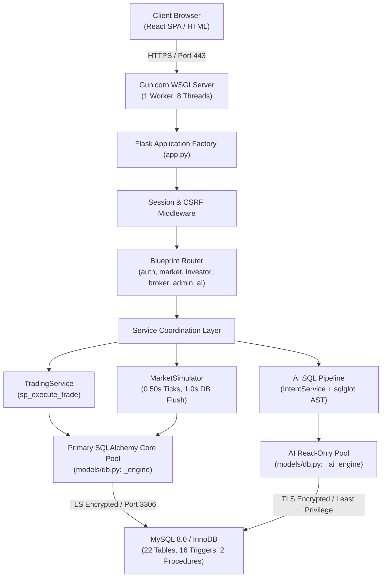
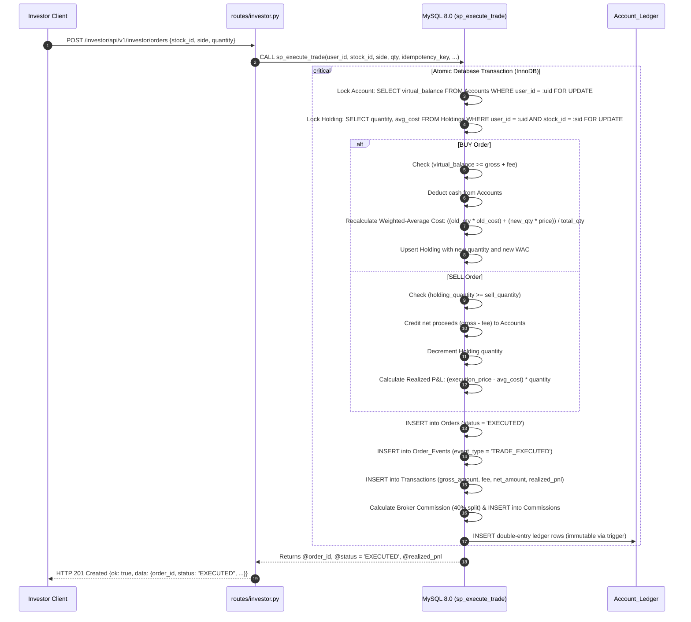
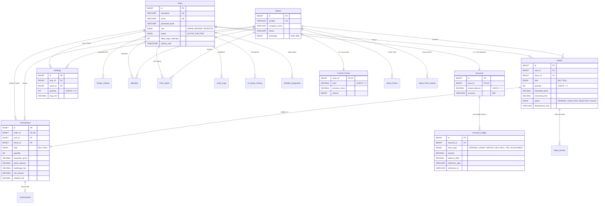

# STOCKTRADE v2 — MASTER PROJECT & PRESENTATION GUIDE
## The Definitive Technical, Architectural, and DBMS Evaluation Manual

> **Document Classification**: Comprehensive All-in-One Presentation & Engineering Reference  
> **System Name**: StockTrade v2  
> **Application Type**: Institutional-Grade Simulated Stock Trading & Relational DBMS Platform  
> **Exchanges Simulated**: National Stock Exchange (NSE) & Bombay Stock Exchange (BSE)  
> **Core Philosophy**: **Virtual Paper Trading Only**. All monetary balances are strictly simulated virtual capital with zero real money exposure, zero third-party broker API dependency, and deterministic financial accounting.  
> **Target Audience**: Evaluators, DBMS Professors, Software Architects, and Presentation Attendees.

---

# TABLE OF CONTENTS
1. [Project Executive Summary & High-Level Purpose](#1-project-executive-summary--high-level-purpose)
2. [What Technologies We Are Using and How We Are Using Them](#2-what-technologies-we-are-using-and-how-we-are-using-them)
3. [End-to-End System Architecture & Execution Flows](#3-end-to-end-system-architecture--execution-flows)
4. [Autonomous Market Simulation & Pricing Mathematics](#4-autonomous-market-simulation--pricing-mathematics)
5. [Atomic Trading Engine & Financial Ledger Accounting](#5-atomic-trading-engine--financial-ledger-accounting)
6. [Complete MySQL 8.0 Database Architecture (22 Tables, 9 Views, 16 Triggers, 2 Procedures)](#6-complete-mysql-80-database-architecture)
7. [AI Text-to-SQL Assistant & Security Defense In Depth](#7-ai-text-to-sql-assistant--security-defense-in-depth)
8. [Complete Feature Breakdown by User Role](#8-complete-feature-breakdown-by-user-role)
9. [Step-by-Step Presentation Script & Live Demo Walkthrough](#9-step-by-step-presentation-script--live-demo-walkthrough)
10. [Viva & Professor Defense Q&A (15 Toughest Technical Questions Answered)](#10-viva--professor-defense-qa)
11. [How to Run, Test, and Verify the Project](#11-how-to-run-test-and-verify-the-project)

---

# 1. Project Executive Summary & High-Level Purpose

### 1.1 What is StockTrade v2?
**StockTrade v2** is a simulated stock-trading web application designed from the ground up as a capstone **Database Management Systems (DBMS)** demonstration. It models the core operational mechanics of an institutional equity brokerage operating on the Indian stock market (NSE/BSE).

Unlike typical toy trading apps that store balances in memory or rely on superficial CRUD operations, StockTrade v2 implements **real-world financial accounting rules**, strict **ACID transactional atomicity**, **row-level locking**, an **append-only immutable ledger**, **16 integrity triggers**, **stored procedures**, and **multi-tenant role-based isolation**.

### 1.2 The Problem It Solves
Most educational trading platforms suffer from three fatal design flaws:
1. **Financial Drift**: They use IEEE 754 floating-point numbers (`FLOAT`/`DOUBLE`), causing fractions of a paisa/cent to disappear or accumulate over time.
2. **Race Conditions**: When two orders or deposits arrive simultaneously, without database-level row locking, an investor can spend the same balance twice.
3. **Destructive Updates**: Many applications directly `UPDATE` cash balances and holdings in place, leaving zero permanent audit trail of *why* the money moved.

### 1.3 The Core Solution in StockTrade v2
StockTrade v2 resolves all three issues by treating the database as the **authoritative single source of truth**:
- Every monetary value is typed as MySQL `DECIMAL(15,2)` and Python `decimal.Decimal`.
- Order placement executes entirely within a native MySQL stored procedure (`sp_execute_trade`) under pessimistic row locks (`SELECT ... FOR UPDATE`).
- Balance mutations write immutable, double-entry audit records to `Account_Ledger`. Triggers reject any attempt to update or delete executed financial records with custom SQLSTATE `'45000'` exceptions.

---

# 2. What Technologies We Are Using and How We Are Using Them

StockTrade v2 avoids unnecessary architectural bloat, selecting industry-standard tools tailored to their specific strengths:

```
┌─────────────────────────────────────────────────────────────────────────────────┐
│                                 CLIENT BROWSER                                  │
│   React 18 SPA (Vite) • Chart.js 4.4 • Lucide React • Custom Fintech Design    │
└────────────────────────────────────────┬────────────────────────────────────────┘
                                         │ HTTPS / REST (JSON) + SSE
                                         ▼
┌─────────────────────────────────────────────────────────────────────────────────┐
│                           APPLICATION SERVER (Flask 3)                          │
│   Python 3.11+ • Flask-Login • Flask-WTF (CSRF) • Flask-Limiter • Gunicorn 21   │
│   Services: MarketSimulator, TradingService, IntentService, QueryExecutor       │
└────────────────────────────────────────┬────────────────────────────────────────┘
                                         │ Parameterized SQL / Stored Procedures
                                         ▼
┌─────────────────────────────────────────────────────────────────────────────────┐
│                       DATABASE ENGINE (MySQL 8.0 / InnoDB)                      │
│   SQLAlchemy 2.0 Core (Explicit SQL) • PyMySQL 1.1 with TLS Project CA          │
│   22 Tables • 9 Views • 16 Triggers • 2 Stored Procedures • Row-Level Locks     │
└─────────────────────────────────────────────────────────────────────────────────┘
```

### 2.1 Backend: Python 3.11+ & Flask 3.0
- **Why We Use It**: Lightweight, explicit, Pythonic microframework allowing full control over HTTP lifecycles, database connections, and background threads without heavy ORM abstractions obscuring SQL queries.
- **How We Use It**:
  - **Application Factory Pattern (`app.py`)**: `create_app()` initializes configurations, extensions, and error handlers dynamically.
  - **Modular Blueprints (`routes/*.py`)**: Segregates endpoints into 7 clean modules: `auth`, `market`, `investor`, `broker`, `admin`, `ai`, `reports`.
  - **Security Middleware**: Configures HTTP headers (`X-Frame-Options: SAMEORIGIN`, `X-Content-Type-Options: nosniff`, `Referrer-Policy`), CSRF token generation via Flask-WTF, and rate limiting (120 req/min) via Flask-Limiter.
  - **Custom Jinja2 Filters**: Registers Indian Rupee currency formatters (`format_inr` $\to$ `₹1,42,500.00`), percentage formatters (`format_pct`), and quantity formatters.

### 2.2 Database Driver & Layer: SQLAlchemy 2.0 Core & PyMySQL 1.1
- **Why We Use It**: We explicitly **avoid SQLAlchemy ORM** for business logic because an ORM hides relational concepts (joins, row locking, stored procedures, execution plans) behind Python objects. SQLAlchemy Core allows us to write explicit, parameterized SQL statements while benefiting from connection pooling.
- **How We Use It**:
  - **Connection Pools (`models/db.py`)**:
    - Primary Pool (`_engine`): Pool size 10, max overflow 20, connection recycling 1800s, pre-ping enabled. Used for all application DML operations.
    - AI Read-Only Pool (`_ai_engine`): Pool size 5, max overflow 10, recycling 1800s. Used exclusively by the AI assistant under read-only privileges (`stocktrade_ai_ro`).
  - **TLS Project CA Validation**: Connects to cloud databases (like Aiven) with encrypted TLS, passing `ssl_ca` to PyMySQL which automatically enforces `verify_mode = ssl.CERT_REQUIRED` and hostname verification.
  - **Context Managers**: `get_db_connection()` and `get_db_transaction()` guarantee clean checkout and return of connections to the pool, preventing connection leaks.

### 2.3 Database Engine: MySQL 8.0+ / InnoDB
- **Why We Use It**: Enterprise-grade relational database engine supporting ACID transactions, true row-level locking (`SELECT ... FOR UPDATE`), check constraints, stored procedures, triggers, and advisory locks.
- **How We Use It**:
  - **InnoDB Storage Engine**: Used for all tables to ensure crash-recovery safety and row-level locking.
  - **Character Set**: `utf8mb4` with `utf8mb4_unicode_ci` collation for multi-language and currency symbol support.
  - **Referential Actions**: `ON DELETE RESTRICT` across all critical financial relations so that accounts, trades, or orders can never be orphaned.

### 2.4 Frontend: React 18, Vite 5 & Custom Fintech Design System
- **Why We Use It**: Delivers a lightning-fast, reactive terminal experience with sub-second page updates without full-page browser reloads.
- **How We Use It**:
  - **Asymmetrical 60/40 Split Gateway (`frontend/src/pages/Login.jsx`)**: Deep midnight navy brand canvas on the left displaying the charging bull geometric brandmark and a live moving marquee ticker tape; crisp white login card on the right.
  - **Vite Bundler (`frontend/vite.config.js`)**: Bundles React JSX, CSS, and assets into `static/dist/`, which is directly served by Flask in production.
  - **Chart.js 4.4 & `react-chartjs-2` (`StockChartModal.jsx`)**: Renders interactive financial candlestick and line charts across 1-minute, 5-minute, and 1-hour historical buckets.
  - **Lucide React**: Clean, minimalist fintech iconography across the terminal.

### 2.5 Autonomous Background Worker: Python Threading & APScheduler
- **Why We Use It**: Financial market prices must move autonomously in real time without requiring human users to trigger page requests.
- **How We Use It**:
  - `MarketSimulator` runs as a singleton background thread spawned inside the master process (`wsgi.py`).
  - Ticks every 500 milliseconds (2 ticks/sec), calculating stochastic price movements.
  - Employs a **decoupled batch persistence architecture**: prices are held in memory and flushed to MySQL `Current_Prices` once per second, preventing database connection exhaustion.
  - Uses MySQL advisory lock (`GET_LOCK('stocktrade_simulator', 0)`) so that only one worker process in a cluster can execute price updates.

### 2.6 AI Subsystem: sqlglot AST Parser, IntentService & LLM Router
- **Why We Use It**: Allows users to ask natural-language questions (e.g. "Show me all banking stocks") while ensuring malicious queries (e.g. "DROP TABLE Users") are mathematically impossible to execute.
- **How We Use It**:
  - **IntentService (`services/intent_service.py`)**: Dynamically indexes all database sectors and symbols at boot, normalizes colloquial synonyms ("banks" $\to$ `Banking`, "delivery" $\to$ `Logistics`), and determines query scope (`ALL` vs `TOP_N`).
  - **LLM Router (`services/llm_router.py`)**: Multi-provider client that routes prompts to Grok (xAI), Gemini, or OpenRouter with configurable timeouts (5s) and automatic fallback.
  - **SQLValidator (`services/sql_validator.py`)**: Uses `sqlglot` to parse generated SQL into an Abstract Syntax Tree (AST). Verifies it is a single `SELECT` statement, blocks all mutations (`INSERT`, `UPDATE`, `DELETE`, `DROP`), blocks disallowed tables, and blocks Cartesian cross-joins.
  - **SemanticValidator (`services/semantic_validator.py`)**: Verifies that the SQL AST actually contains the sector filters and entities the user asked for. If an LLM hallucinates an unrelated query, it automatically rejects it and substitutes a deterministic schema fallback.
  - **QueryExecutor (`services/query_executor.py`)**: Executes validated queries under read-only session variables (`SET SESSION TRANSACTION READ ONLY; SET @current_user_id = :uid;`) and max execution timeouts (5000ms).

---

# 3. End-to-End System Architecture & Execution Flows

### 3.1 High-Level Component Interaction Flow



### 3.2 Application Startup Lifecycle
1. **WSGI Boot (`wsgi.py`)**: Gunicorn invokes `create_app(FLASK_ENV)`.
2. **Configuration Loading (`config.py`)**: Reads environment variables (`DB_HOST`, `DB_PORT`, `SECRET_KEY`, `DB_SSL`, etc.). Enforces that production `SECRET_KEY` is a secure 64-hex string.
3. **Engine Initialization (`models/db.py`)**: Initializes `_engine` and `_ai_engine` connection pools with TLS Project CA verification.
4. **Extension Attachment**: Attaches Flask-Login (`login_manager`), Flask-WTF (`csrf`), and Flask-Limiter (`limiter`).
5. **Blueprint Registration**: Registers all 7 blueprints and configures custom error handlers (returning JSON for API routes and HTML for browser routes).
6. **Market Simulator Launch**: Spawns `MarketSimulator` singleton thread. Simulator acquires MySQL advisory lock `GET_LOCK('stocktrade_simulator', 0)`, hydrates 104 active stock quotes into memory, and begins ticking every 500ms.

---

# 4. Autonomous Market Simulation & Pricing Mathematics

StockTrade v2 features a market simulation engine operating independently of user requests.

### 4.1 Stochastic Pricing Formula (Geometric Brownian Motion with Mean Reversion)
Every 500ms, each listed equity $i$ calculates its next price tick using:

$$\Delta P_i = P_{i,t} \times \left( \mu_i \cdot \Delta t + \sigma_{sector} \cdot \sqrt{\Delta t} \cdot Z + \kappa \cdot (\bar{P}_{sector} - P_{i,t}) \cdot \Delta t \right)$$

Where:
- $P_{i,t}$ is the current price.
- $\Delta t = 0.50$ seconds (tick interval).
- $\sigma_{sector}$ is the calibrated sector volatility multiplier (e.g. IT = 0.015, Banking = 0.012, FMCG = 0.008, Pharmaceuticals = 0.011).
- $Z \sim \mathcal{N}(0, 1)$ is a standard Gaussian random variable drawn from an independent deterministic generator `random.Random(seed + stock_id * 1009)`.
- $\kappa$ is the mean-reversion drift pull preventing runaway asset inflation or collapse.

### 4.2 Circuit Limits & Exchange Safeguards
1. **Per-Tick Clamp**: Maximum price jump per tick is bounded to $\pm 0.50\%$ of current price (`MAX_TICK_PCT = 0.005`).
2. **Daily Circuit Breakers**: Bounded to $\pm 10.0\%$ from the prior close (`CIRCUIT_LIMIT_PCT = 0.10`):
   $$P_{min} = P_{prev\_close} \times 0.90, \quad P_{max} = P_{prev\_close} \times 1.10$$
   If market movement touches $P_{min}$ or $P_{max}$, the price freezes at the circuit boundary.
3. **Decoupled Batch Persistence**: The high-frequency tick thread modifies only in-memory dictionaries. A dedicated flush thread writes batch updates to `Current_Prices` and inserts into `Stock_Prices` once per second, eliminating connection pool starvation.

---

# 5. Atomic Trading Engine & Financial Ledger Accounting

### 5.1 Authoritative Order Execution (`sp_execute_trade`)
All buy and sell orders execute within the MySQL stored procedure `sp_execute_trade` in [`database/procedures.sql`](file:///c:/Users/zades/OneDrive/Pictures/Desktop/DBMSPRJ/database/procedures.sql).



### 5.2 Key Mathematical & Accounting Formulas

#### 1. Weighted-Average Cost (WAC) Basis on BUY Orders
When buying additional shares of an already-held equity:
$$\text{WAC}_{new} = \frac{(Q_{existing} \times \text{AvgCost}_{existing}) + (Q_{new} \times P_{execution})}{Q_{existing} + Q_{new}}$$

#### 2. Realized Profit and Loss on SELL Orders
When selling shares, the profit or loss is realized immediately:
$$\text{Realized P\&L} = (P_{execution} - \text{WAC}_{holding}) \times Q_{sold}$$

#### 3. Platform Brokerage Fee Calculation
$$\text{Gross Amount} = Q \times P_{execution}$$
$$\text{Brokerage Fee} = \max(\text{Gross Amount} \times 0.0010, \text{₹}1.00)$$
$$\text{Net Settlement (BUY)} = \text{Gross Amount} + \text{Brokerage Fee}$$
$$\text{Net Settlement (SELL)} = \text{Gross Amount} - \text{Brokerage Fee}$$

#### 4. Institutional Broker Commission Split
When an assigned investor trades, the broker earns a 40% platform-funded commission:
$$\text{Broker Commission} = \text{Brokerage Fee} \times 0.40$$

---

# 6. Complete MySQL 8.0 Database Architecture

The database architecture is designed in Third Normal Form (3NF) and Boyce-Codd Normal Form (BCNF), utilizing 22 relational tables, 9 projection views, 16 triggers, and 2 stored procedures.

### 6.1 Complete Entity-Relationship (ER) Diagram



### 6.2 Table Inventory (22 Tables)
1. `Users`: System accounts, PBKDF2/scrypt password hashes, roles, brute-force lockout status.
2. `Accounts`: Virtual cash balance store (`CHECK (virtual_balance >= 0)`).
3. `Account_Ledger`: Append-only, double-entry financial ledger records.
4. `Stocks`: Master directory of 104 equities across 10 sectors (NSE/BSE).
5. `Current_Prices`: 1:1 live quote cache containing real-time price, day open/high/low, volume.
6. `Stock_Prices`: 1-minute historical tick log for simulation analytics.
7. `Stock_Price_Hourly`: Hourly aggregated OHLC rollups for historical charting.
8. `Orders`: Order submission records with idempotency keys and state tracking.
9. `Order_Events`: Append-only event-sourcing audit trail for order status transitions.
10. `Holdings`: Open investor share positions and weighted-average purchase cost.
11. `Transactions`: Permanent, immutable financial trade execution receipts.
12. `Broker_Clients`: M:N broker-investor assignment history with generated column enforcing a single active broker per investor.
13. `Commission_Rules`: System rate table for investor brokerage (0.10%) and broker commission splits (40%).
14. `Commissions`: Platform-funded broker commission records attributed to client trades.
15. `Watchlist`: Personal monitored ticker inventory per investor.
16. `Price_Alerts`: Conditional target price alerts (`ABOVE` / `BELOW`).
17. `Audit_Logs`: Security audit trail capturing logins, lockouts, and admin operations.
18. `AI_Query_History`: Audit log of all natural-language prompts, generated SQL, durations, and validation statuses.
19. `Saved_Reports`: User-saved custom reporting queries.
20. `System_Settings`: Global key-value operational parameters.
21. `System_Events`: System operational alert log (warnings, critical errors).
22. `Portfolio_Snapshots`: Daily historical balance snapshots for performance tracking.

### 6.3 Security Projection Views (9 Views)
- `v_market_latest`: Live market quotes with computed day change amount and percentage.
- `v_investor_portfolio`: Holdings, cost basis, live market values, and unrealized returns.
- `v_investor_transactions`: Executed trade history filtered by investor ID.
- `v_broker_client_summary`: Assigned clients summary: investor name, email, cash balance, total trades, volume, commissions.
- `v_broker_client_transactions`: Client trades visible strictly to the assigned broker.
- `v_broker_commissions`: Commission earnings per trade for the authenticated broker.
- `v_admin_trade_facts`: Global system-wide trade facts and volume metrics.
- `v_admin_user_audit`: User accounts without password hashes, exposing lockout timestamps.
- `v_admin_audit_logs`: Administrative audit trail with resolved usernames and roles.

### 6.4 The 16 Database Triggers
1. `trg_ledger_block_update`: Blocks any `UPDATE` on `Account_Ledger` (SQLSTATE `'45000'`).
2. `trg_ledger_block_delete`: Blocks any `DELETE` on `Account_Ledger` (SQLSTATE `'45000'`).
3. `trg_transactions_block_update`: Blocks any `UPDATE` on `Transactions` (SQLSTATE `'45000'`).
4. `trg_transactions_block_delete`: Blocks any `DELETE` on `Transactions` (SQLSTATE `'45000'`).
5. `trg_commissions_block_update`: Blocks any `UPDATE` on `Commissions` (SQLSTATE `'45000'`).
6. `trg_commissions_block_delete`: Blocks any `DELETE` on `Commissions` (SQLSTATE `'45000'`).
7. `trg_orders_block_terminal_update`: Blocks updates to completed orders (`EXECUTED`, `REJECTED`, `FAILED`).
8. `trg_orders_block_delete`: Blocks any `DELETE` on `Orders` (SQLSTATE `'45000'`).
9. `trg_audit_logs_block_update`: Blocks any `UPDATE` on `Audit_Logs` (SQLSTATE `'45000'`).
10. `trg_audit_logs_block_delete`: Blocks any `DELETE` on `Audit_Logs` (SQLSTATE `'45000'`).
11. `trg_broker_clients_role_insert`: Validates `broker_id` is a BROKER and `investor_id` is an INVESTOR.
12. `trg_broker_clients_role_update`: Enforces identical role verification upon status update.
13. `trg_orders_audit_insert`: Automatically appends status transitions to `Order_Events` upon order creation.
14. `trg_orders_audit_update`: Automatically appends status transitions to `Order_Events` upon status mutation.
15. `trg_order_events_block_update`: Blocks any `UPDATE` on `Order_Events` (SQLSTATE `'45000'`).
16. `trg_order_events_block_delete`: Blocks any `DELETE` on `Order_Events` (SQLSTATE `'45000'`).

### 6.5 The 2 Stored Procedures
1. `sp_execute_trade`: Authoritative trade execution procedure enforcing row locks, idempotency, WAC cost basis, realized P&L, double-entry ledger entries, and platform commission splits.
2. `sp_reconcile_financial_integrity`: 7-point automated financial integrity audit verifying:
   - Account Cash Balance $\equiv \sum \text{Account\_Ledger.amount}$
   - Holdings Quantity $\equiv \sum (\text{BUY} - \text{SELL})$
   - No executed orders missing transactions.
   - No completed transactions missing ledger entries.
   - Broker commissions match formula: $\text{fee} \times 0.40$.
   - No duplicate order transactions.
   - Every investor account has exactly one ₹100,000 opening grant.

---

# 7. AI Text-to-SQL Assistant & Security Defense In Depth

The AI SQL Assistant (`/ai/api/v1/ai/*`) provides natural-language database querying without exposing the database to SQL injection, privilege escalation, or unauthorized data visibility.

```
User Question: "Show me all banking stocks"
       │
       ▼
[Stage 1: IntentService] ──────────► Resolves dynamic entities: Sector='Banking', Scope=ALL (No LIMIT 10)
       │
       ▼
[Stage 2: LLM Router / RAG] ───────► Assembles schema prompt; queries Grok/Gemini/OpenRouter
       │
       ▼
[Stage 3: sqlglot AST Validator] ──► Confirms single SELECT; verifies only allowed views used
       │
       ▼
[Stage 4: SemanticValidator] ──────► Verifies SQL includes `WHERE sector = 'Banking'`
       │
       ▼
[Stage 5: Scoped Execution] ───────► Connects via least-privilege user `stocktrade_ai_ro`
                                     SET SESSION TRANSACTION READ ONLY;
                                     SET @current_user_id = :uid;
                                     SET max_execution_time = 5000;
       │
       ▼
[Stage 6: Grounded Analysis] ──────► Explains returned data; logs query to AI_Query_History
```

### Defense-in-Depth Security Layers
1. **Dynamic Entity Grounding (`IntentService`)**: Maps informal sector synonyms ("banks" $\to$ `Banking`, "chemicals" $\to$ `Chemicals`, "delivery" $\to$ `Logistics`). If a prompt asks an out-of-domain question (e.g. "What is the capital of France?"), it is rejected immediately with an informative message without executing SQL.
2. **AST Allowlist Parsing (`sqlglot`)**: Reject stacked queries (`;`), mutations (`INSERT`, `UPDATE`, `DELETE`, `DROP`), direct access to underlying base tables (`Users`, `Holdings`, `Accounts`), and Cartesian cross-joins.
3. **Semantic Consistency Verification**: If an LLM returns an unrelated query (such as top stocks by volume) when asked for banks, the semantic guard detects the missing sector condition, rejects the query, and substitutes a deterministic schema fallback.
4. **Least-Privilege Database Account**: Queries execute under `stocktrade_ai_ro`. In MySQL, this user possesses only `SELECT` privileges on the 9 projection views.
5. **Session Tenancy Enforcement**: Queries run under `SET @current_user_id = :uid;`. Views automatically filter rows where `user_id = @current_user_id`, making cross-tenant data leakage impossible even if a user prompts the AI to "show all other users' trades".

---

# 8. Complete Feature Breakdown by User Role

### 8.1 Public / Authentication
- **Asymmetrical Split Login Terminal**: 60/40 visual split with dynamic moving marquee stock ticker.
- **Evaluation Demo Accounts**: One-click demo credential pills for fast evaluator access.
- **Brute-Force Lockout Defense**: 5 failed login attempts lock account for 15 minutes.

### 8.2 Retail Investor Role (`INVESTOR`)
- **Portfolio Terminal**: View real-time portfolio market value, available cash, cost basis, and unrealized gains.
- **Live Market Screener**: Complete directory of 104 equities with sector filtering, search, and real-time 500ms ticker updates.
- **Interactive Trade Ticket Modal**: Market BUY / SELL order placement with real-time gross amount, brokerage fee estimation, and cash check.
- **Virtual Cash Deposits**: Deposit virtual capital with instantaneous double-entry ledger crediting.
- **Trade Execution History**: Chronological transaction history with realized P&L and RFC 4180 CSV export.
- **Watchlist & Price Alerts**: Monitor equities and configure automated conditional price alerts (`ABOVE` / `BELOW`).
- **Assigned Broker View**: Inspect assigned institutional broker details and firm information.

### 8.3 Institutional Broker Role (`BROKER`)
- **Client Roster**: View all assigned investors, virtual cash balances, trade counts, and portfolio volume.
- **Client Onboarding**: Onboard and assign unassigned investors to the broker's portfolio.
- **Client Portfolio Inspection**: Inspect assigned client holdings and transaction history (strictly isolated; attempting to access unassigned investors returns HTTP 404).
- **Client Assignment Termination**: End client advisory relationships.
- **Commission Analytics**: Comprehensive breakdown of earned 40% commission splits with daily earnings graphs.

### 8.4 System Administrator Role (`ADMIN`)
- **Platform Overview**: Global KPI cards: total registered users, active stocks, daily trade turnover, collected fees.
- **Listed Equity CRUD**: Add new listed companies, update corporate metadata, and toggle active/inactive status.
- **User Account Management**: View failed login counters, toggle account statuses, and reset brute-force lockouts.
- **Security Audit Logs**: Immutable system audit trail capturing IP addresses, actions, and timestamps.
- **Market Simulator Controls**: Adjust tick interval (0.1s to 5.0s), modify volatility multipliers, and pause/resume simulation.
- **Automated Financial Reconciliation**: Trigger system-wide audit of all 7 financial invariants (`sp_reconcile_financial_integrity`).

---

# 9. Step-by-Step Presentation Script & Live Demo Walkthrough

Use this script during evaluations or technical demonstrations:

```
┌─────────────────────────────────────────────────────────────────────────────────┐
│                           PRESENTATION TIMELINE (10 MIN)                        │
│   00:00 - 02:00: Problem Statement, DBMS Objectives & Tech Stack                │
│   02:00 - 04:30: Live Demo — Investor Trading, WAC Math & Ledger Immutability   │
│   04:30 - 06:00: Live Demo — Broker Tenant Isolation & Commission Analytics     │
│   06:00 - 07:30: Live Demo — Admin Controls & 7-Point Financial Reconciliation  │
│   07:30 - 09:00: Live Demo — AI SQL Assistant & AST Injection Defense           │
│   09:00 - 10:00: Concluding Defense: Stored Procedures & Row Locking            │
└─────────────────────────────────────────────────────────────────────────────────┘
```

### Phase 1: The Introduction (2 Minutes)
- **Speaker Script**:  
  *"Good morning/afternoon, evaluators. Today I am presenting StockTrade v2, an institutional simulated trading platform built as a capstone Database Management Systems (DBMS) project. While many trading apps are simple CRUD interfaces with mock data, StockTrade v2 is designed around strict database correctness: native MySQL 8.0 ACID transactions, pessimistic row-level locking, an append-only double-entry ledger, 16 integrity triggers, and a mathematical engine that prevents floating-point drift."*
- **Visual**: Show the Login screen at `http://127.0.0.1:5000` with the asymmetrical 60/40 layout and live animated stock ticker tape.

### Phase 2: Live Demo — Investor Trading Flow (2.5 Minutes)
1. **Login**: Click the demo pill for `investor_rahul` (`Investor@StockTrade2026`).
2. **Dashboard**: Highlight Buying Power (e.g. ₹1,00,000.00) and explain that this balance is backed by `Accounts.virtual_balance`.
3. **Execute BUY Order**:
   - Navigate to **Market** $\to$ Select **TCS** (Tata Consultancy Services).
   - Open Trade Ticket $\to$ Buy **10 shares** $\to$ Show estimated gross, ₹1.00 minimum brokerage fee, and net settlement.
   - Click **Execute Order**.
   - Show instantaneous update: cash decreases, 10 shares appear in **Portfolio** with Weighted-Average Cost (WAC).
4. **Execute SELL Order (Realized P&L)**:
   - Wait for the autonomous market simulator to tick the price higher.
   - Click **Sell 5 shares** $\to$ Execute.
   - Navigate to **Transactions** $\to$ Point out the green **Realized P&L** amount.
5. **DBMS Proof**: Explain that this operation was not executed in Python, but inside stored procedure `sp_execute_trade` with `SELECT ... FOR UPDATE` row locks.

### Phase 3: Live Demo — Broker Tenant Isolation (1.5 Minutes)
1. **Switch Role**: Sign out and log in as `broker_arun` (`Broker@StockTrade2026`).
2. **Client Roster**: Show Arun's assigned clients (Rahul, Sneha, Vikram).
3. **Demonstrate Tenant Isolation**:
   - Explain that client data is projected via `v_broker_client_summary` where `broker_id = current_user.id`.
   - If Arun tries to query client data belonging to Broker Priya, the backend returns a strict HTTP 404.
4. **Commission Earnings**: Open **Analytics** and show the 40% commission split automatically earned from Rahul's earlier trade.

### Phase 4: Live Demo — Admin & Financial Reconciliation (1.5 Minutes)
1. **Switch Role**: Sign out and log in as `admin` (`Admin@StockTrade2026`).
2. **System Health**: Show platform-wide volume, total users, and active listed equities.
3. **Simulator Controls**: Navigate to **Simulator** $\to$ Adjust tick speed slider $\to$ Show live simulator reacting.
4. **Audit Logs**: Navigate to **Audit Logs** $\to$ Show immutable records of logins, order executions, and lockouts.
5. **Run Reconciliation**: Explain procedure `sp_reconcile_financial_integrity`, which executes all 7 financial invariant checks across the database.

### Phase 5: Live Demo — AI SQL Assistant & Security Defense (1.5 Minutes)
1. **Open AI Console**: Navigate to `/ai/assistant`.
2. **Ask Natural Language Question**: Type `"Show me all banking stocks"`.
   - Point out that it dynamically resolved to `WHERE sector = 'Banking'`, returned all 8 bank stocks, and provided a grounded natural-language summary.
3. **Demonstrate Injection Defense**:
   - Type `"DROP TABLE Users"` or `"DELETE FROM Orders"`.
   - Show the prompt being immediately rejected with HTTP 422 Bad Request.
   - Explain how `sqlglot` inspected the AST and blocked the statement before it ever reached the database.

---

# 10. Viva & Professor Defense Q&A

### Q1: Why did you use Stored Procedures (`sp_execute_trade`) instead of writing trade logic in Python?
**Answer**:  
*"Writing trade logic in Python creates a severe concurrency vulnerability known as the Time-of-Check to Time-of-Use (TOCTOU) race condition. If two orders arrive simultaneously, Python could read the same cash balance for both, validate both, and deduct cash twice, resulting in a negative balance. By encapsulating trade logic inside `sp_execute_trade`, MySQL executes `SELECT virtual_balance FROM Accounts WHERE user_id = :uid FOR UPDATE`. This row lock guarantees serialized execution at the database level. If any condition fails, the procedure's `EXIT HANDLER FOR SQLEXCEPTION` executes an atomic `ROLLBACK`, guaranteeing ACID atomicity."*

### Q2: Why did you not use SQLAlchemy ORM for the business layer?
**Answer**:  
*"SQLAlchemy ORM abstracts relational tables into Python objects, which frequently leads to the N+1 query problem, hidden automatic flushes, and an inability to enforce explicit locking semantics like `SELECT ... FOR UPDATE` across stored procedures. StockTrade v2 uses **SQLAlchemy 2.0 Core**, which provides robust connection pooling while requiring explicit, parameterized SQL statements. This ensures complete transparency and showcases direct DBMS competence."*

### Q3: How do you prevent financial floating-point drift?
**Answer**:  
*"We strictly forbid IEEE 754 floating-point data types (`FLOAT` and `DOUBLE`) in our database and accounting services. All monetary columns in MySQL use `DECIMAL(15,2)` for currency and `DECIMAL(12,4)` for prices and average costs. In Python, all math uses `decimal.Decimal` with explicit `ROUND_HALF_UP` rounding. This guarantees that ₹100,000.00 minus ₹1,425.50 is always exactly ₹98,574.50 with zero fractional drift."*

### Q4: How is the Account Ledger made strictly append-only?
**Answer**:  
*"We enforce ledger immutability at the database engine level using two triggers in `database/triggers.sql`: `trg_ledger_block_update` and `trg_ledger_block_delete`. Both triggers execute `BEFORE UPDATE` and `BEFORE DELETE` on `Account_Ledger` and raise a custom exception: `SIGNAL SQLSTATE '45000' SET MESSAGE_TEXT = 'Account_Ledger is strictly append-only'`. Even if a developer accidentally wrote an update query in application code, MySQL itself rejects the query."*

### Q5: How do you ensure tenant isolation between different investors and brokers?
**Answer**:  
*"We implement defense in depth across three layers:*  
*1. **Route Layer**: Flask-Login session cookies verify user identity, and `@role_required` decorators restrict portal access.*  
*2. **Application SQL Layer**: All queries explicitly bind `WHERE user_id = :current_user_id`.*  
*3. **Database View Layer**: Projection views like `v_broker_client_transactions` join `Broker_Clients` on `status = 'ACTIVE'`, ensuring brokers can never see unassigned clients. In the AI Assistant, session variables (`SET @current_user_id = :uid`) filter views automatically."*

### Q6: What prevents an attacker from executing SQL injections through the AI Assistant?
**Answer**:  
*"We employ a four-stage defense-in-depth pipeline:*  
*1. **Intent Grounding**: Out-of-domain questions are rejected before SQL generation.*  
*2. **AST Validation**: The query is parsed into an Abstract Syntax Tree via `sqlglot`. It must be a single `SELECT` statement. All mutation keywords (`DROP`, `ALTER`, `INSERT`, `UPDATE`, `DELETE`) are blocked.*  
*3. **View Allowlist**: Queries can only target 9 pre-approved projection views. Direct access to base tables (`Users`, `Accounts`, `Holdings`) is blocked.*  
*4. **Least-Privilege Database User**: Queries execute under `stocktrade_ai_ro` with `SET SESSION TRANSACTION READ ONLY` and a 5000ms query timeout."*

### Q7: How does the Weighted-Average Cost (WAC) formula work when an investor buys stocks at different prices?
**Answer**:  
*"Inside `sp_execute_trade`, if an investor already owns $Q_1$ shares at average price $P_1$ and buys $Q_2$ shares at price $P_2$, the new cost basis is recalculated as:*  
$$\text{New WAC} = \frac{(Q_1 \times P_1) + (Q_2 \times P_2)}{Q_1 + Q_2}$$  
*This is updated atomically on `Holdings.avg_cost`. When the investor later sells shares, the realized profit is calculated as $(P_{sell} - \text{WAC}) \times Q_{sold}$."*

### Q8: What happens if two orders arrive simultaneously for the same stock?
**Answer**:  
*"MySQL InnoDB's row-level locking serializes the execution. When the first order calls `sp_execute_trade`, it acquires an exclusive lock (`FOR UPDATE`) on the investor's `Accounts` and `Holdings` rows. The second order blocks and waits until the first transaction executes `COMMIT`. The second order then reads the updated cash balance, preventing double-spending."*

### Q9: How do you prevent duplicate order execution if a user double-clicks the Buy button?
**Answer**:  
*"Every order submission generates a unique UUID v4 `idempotency_key` on the client. `Orders` enforces a unique composite constraint: `UNIQUE KEY uq_orders_user_idempotency (user_id, idempotency_key)`. Inside `sp_execute_trade`, the first step queries `Orders` for that key. If found, it immediately returns the existing execution receipt without executing trade logic or mutating balances."*

### Q10: How does the market simulator generate realistic price movement?
**Answer**:  
*"It uses Geometric Brownian Motion with mean reversion and sector-specific volatility multipliers. Prices tick every 500ms using independent pseudo-random seeds per symbol. To ensure realistic trading, movement is clamped to a maximum of $\pm 0.50\%$ per tick, and daily movements are bounded to $\pm 10.0\%$ circuit limit bands from previous close."*

### Q11: Why is the market simulator's database persistence decoupled from its tick loop?
**Answer**:  
*"Ticking 104 equities twice every second would require over 200 individual SQL UPDATE queries per second. That would exhaust the database connection pool and saturate disk I/O. Instead, our simulator updates an in-memory dictionary every 500ms and uses a separate thread to flush batch updates to `Current_Prices` once every second. This reduces database operations by over 80% while preserving real-time accuracy."*

### Q12: What is the purpose of `sp_reconcile_financial_integrity`?
**Answer**:  
*"It is an automated financial audit procedure verifying 7 core mathematical invariants across the entire database. It confirms that every account's cash balance matches the exact sum of its ledger entries, holding quantities match net executed trades, every executed order has a transaction, and every investor has a valid ₹100,000 opening grant. If any discrepancy exists, it reports the count and account IDs immediately."*

### Q13: What is the purpose of the `Order_Events` table and its triggers?
**Answer**:  
*"It provides event sourcing for orders. When an order transitions from `NEW` $\to$ `PENDING` $\to$ `EXECUTED` (or `REJECTED`), triggers `trg_orders_audit_insert` and `trg_orders_audit_update` automatically append a row to `Order_Events` with the old status, new status, timestamp, and rejection reason. Triggers `trg_order_events_block_update` and `delete` make this lifecycle history permanently immutable."*

### Q14: How does StockTrade v2 connect securely to cloud databases like Aiven?
**Answer**:  
*"Aiven MySQL requires TLS encryption with a custom Project CA certificate (`aiven-ca.pem`). In `models/db.py`, our engine configuration sets `query_params['ssl_ca'] = db_ssl_ca`. PyMySQL loads this certificate, enabling `ssl.CERT_REQUIRED` and verifying hostname identity. We also support `DB_SSL_CA_CONTENT` as an environment variable to write the certificate dynamically to a temporary file on cloud platforms like Render."*

### Q15: How many automated tests exist, and what do they verify?
**Answer**:  
*"We have **136 automated tests** written in pytest, passing with a 100% success rate. They test atomic trade execution, partial sell realized P&L math, WAC recalculation, ledger immutability triggers, race conditions, brute-force lockouts, AST SQL injection blocking, AI sector intent resolution, broker onboarding, and financial reconciliation."*

---

# 11. How to Run, Test, and Verify the Project

### 11.1 Prerequisites
- **Python**: 3.11 or higher
- **Node.js**: v18.0 or higher
- **MySQL**: 8.0 or higher (Local or Aiven Cloud MySQL)

### 11.2 One-Click Startup (PowerShell)
```powershell
.\start.ps1
```
This automatically verifies the virtual environment, builds the React frontend if missing, launches the Flask backend, and starts the autonomous market simulator on `http://127.0.0.1:5000`.

### 11.3 Manual Execution Commands

#### 1. Start Flask Backend & Simulator:
```powershell
.\.venv\Scripts\python app.py
```
*Access URL*: `http://127.0.0.1:5000`

#### 2. Start Vite Frontend Development Server (Hot-Reload):
```powershell
npm --prefix frontend run dev
```
*Access URL*: `http://localhost:3000` (proxies API traffic to port 5000)

#### 3. Compile Production Frontend Bundle:
```powershell
npm --prefix frontend run build
```
Outputs minified assets directly to `static/dist/`.

#### 4. Run the Full 136-Test Automated Suite:
```powershell
.\.venv\Scripts\pytest -v
```

### 11.4 Evaluation Demo Credentials

| Role | Username | Password | Permitted Portal & Scope |
| :--- | :--- | :--- | :--- |
| **System Administrator** | `admin` | `Admin@StockTrade2026` | Full platform overview, company CRUD, lockout resets, audit logs |
| **Institutional Broker 1** | `broker_arun` | `Broker@StockTrade2026` | Manages clients Rahul, Sneha, and Vikram; commission analytics |
| **Institutional Broker 2** | `broker_priya` | `Broker@StockTrade2026` | Manages clients Ananya and Karan; commission analytics |
| **Investor 1 (Managed)** | `investor_rahul` | `Investor@StockTrade2026` | Active investor assigned to Arun; ₹1,00,000 buying power, trading |
| **Investor 2 (Managed)** | `investor_sneha` | `Investor@StockTrade2026` | Wealth client assigned to Arun; long-term equity portfolio |
| **Investor 3 (Direct)** | `investor_rohit` | `Investor@StockTrade2026` | Direct market participant (unassigned / self-directed) |

*(All accounts also accept the universal evaluation demo password: `DemoPassword123!`)*
