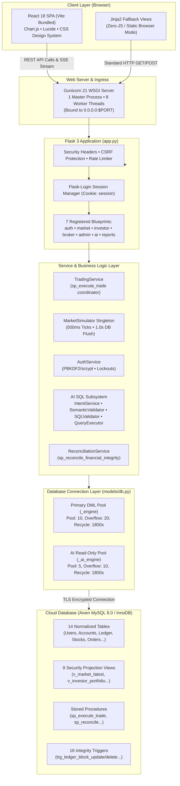
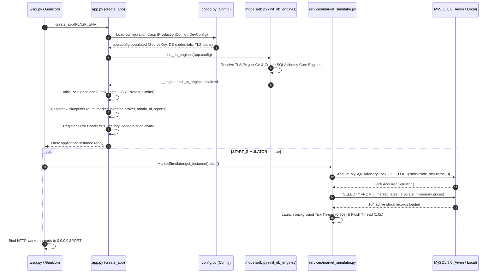
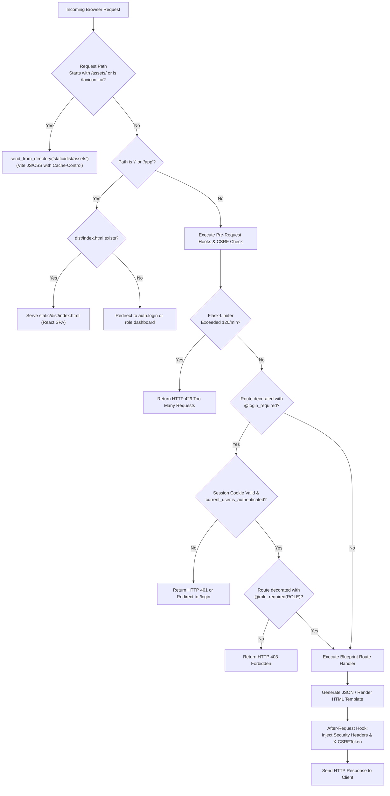
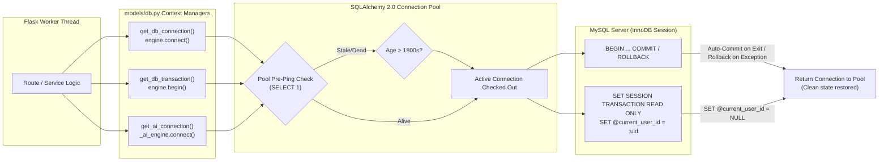
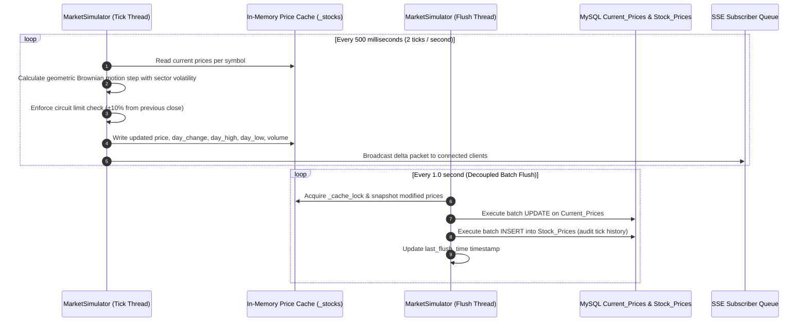
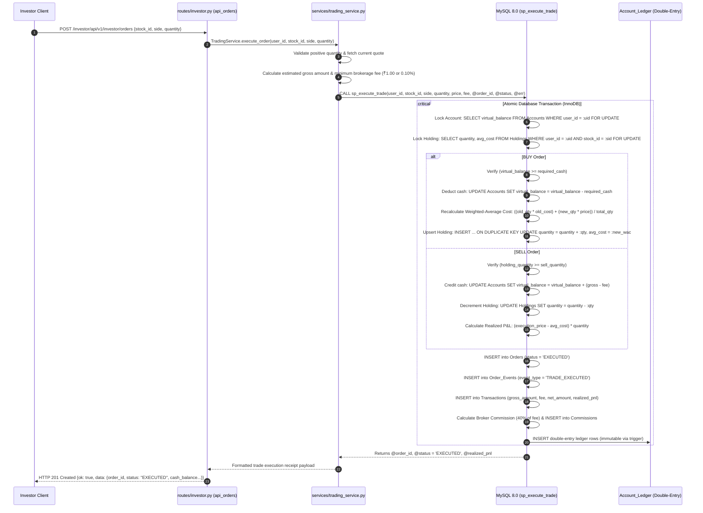
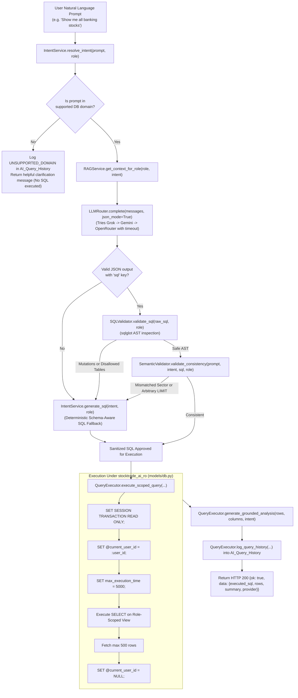
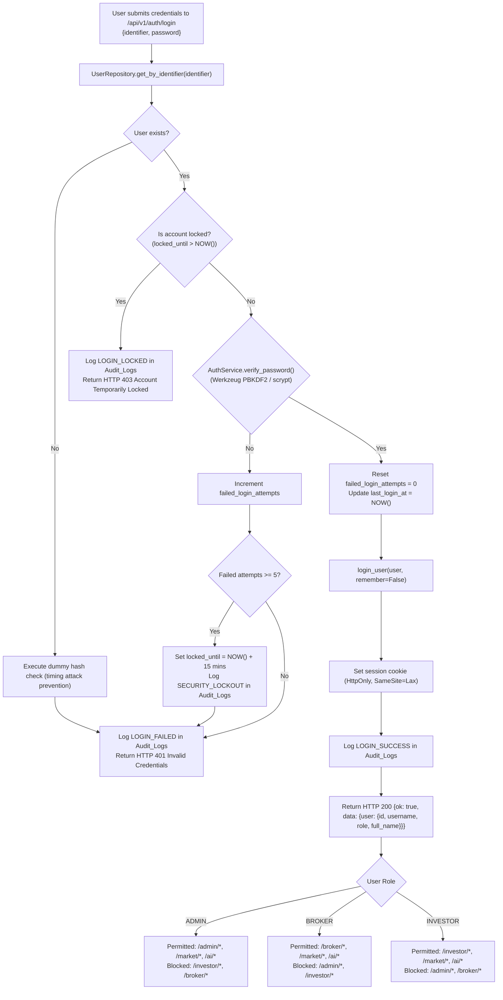

# StockTrade v2 — Architecture & Application Execution Flows

This document details the software architecture, component boundaries, and end-to-end execution flows of StockTrade v2 based on direct source code analysis.

---

## 1. High-Level Architecture Overview

StockTrade v2 employs a hybrid architecture:
- **Client Layer**: A modern React 18 Single-Page Application (SPA) built with Vite, complemented by a complete set of Jinja2 server-rendered fallback templates.
- **Web / Application Layer**: Flask 3.0 configured via an Application Factory (`app.py`), running behind Gunicorn with 1 worker process and 8 threads.
- **Autonomous Worker**: An in-memory, thread-driven stochastic market simulation engine with decoupled database batch persistence.
- **Data Access & Business Layer**: Strict service-to-repository-to-database boundaries using explicit parameterized SQL via SQLAlchemy 2.0 Core.
- **Database Engine**: Native MySQL 8.0 / InnoDB enforcing ACID transaction boundaries, row-level locking (`SELECT ... FOR UPDATE`), append-only ledger immutability via triggers, and authoritative trade execution via stored procedures.

---

## 2. Mermaid Architecture & Execution Flow Diagrams

### Diagram 1: High-Level Application Architecture

---

### Diagram 2: Application Startup Sequence

---

### Diagram 3: Browser Request-to-Response Flow

---

### Diagram 4: Database Connection Lifecycle & Pool Management

---

### Diagram 5: Market Simulation & Decoupled Price Update Flow

---

### Diagram 6: Buy/Sell Order Execution Flow (sp_execute_trade)

---

### Diagram 7: AI SQL Generation, Validation & Scoped Execution Flow

---

### Diagram 8: Authentication & Role-Based Authorization Flow

