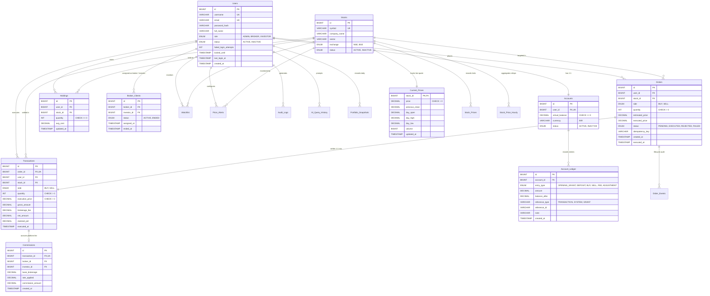

# StockTrade v2 — Complete MySQL Database Schema Documentation

**Database Engine**: MySQL 8.0+ (InnoDB)  
**Character Set / Collation**: `utf8mb4` / `utf8mb4_unicode_ci`  
**Referential Integrity**: Strict `ON DELETE RESTRICT` (No cascading drops of financial records)  
**Precision**: `DECIMAL(15,2)` for financial cash amounts; `DECIMAL(12,4)` for stock prices and average costs  

---

## 1. Entity-Relationship (ER) Diagram



---

## 2. Table-by-Table Technical Specifications

### Table 1: `Users`
- **Purpose**: System identity, role-based access, credential authentication, and brute-force lockout tracking.
- **Columns**:
  - `id` (BIGINT, PK, AUTO_INCREMENT): Unique user identifier.
  - `username` (VARCHAR(50), NOT NULL, UNIQUE): Unique system username.
  - `email` (VARCHAR(100), NOT NULL, UNIQUE): User email address.
  - `password_hash` (VARCHAR(255), NOT NULL): Werkzeug-compatible PBKDF2/scrypt hashed password.
  - `full_name` (VARCHAR(100), NOT NULL): Legal person or entity name.
  - `phone` (VARCHAR(20), NULL): Optional phone contact number.
  - `role` (ENUM('ADMIN', 'BROKER', 'INVESTOR'), NOT NULL): Operational role.
  - `status` (ENUM('ACTIVE', 'INACTIVE'), NOT NULL, DEFAULT 'ACTIVE'): Account operational status.
  - `is_demo` (BOOLEAN, NOT NULL, DEFAULT FALSE): Academic evaluation account flag.
  - `failed_login_attempts` (INT, NOT NULL, DEFAULT 0): Consecutive failed password counter.
  - `locked_until` (TIMESTAMP, NULL, DEFAULT NULL): Lockout expiration timestamp.
  - `last_login_at` (TIMESTAMP, NULL, DEFAULT NULL): Last successful login timestamp.
  - `created_at`, `updated_at` (TIMESTAMP, NOT NULL, DEFAULT CURRENT_TIMESTAMP).
- **Indexes**: `idx_users_role_status` (`role`, `status`), `idx_users_email` (`email`).
- **Referenced by**: `Accounts`, `Orders`, `Holdings`, `Transactions`, `Broker_Clients`, `Commissions`, `Watchlist`, `Price_Alerts`, `Audit_Logs`, `AI_Query_History`, `Portfolio_Snapshots`.

### Table 2: `Accounts`
- **Purpose**: Financial cash balance store (1:1 with Investor/Broker user).
- **Columns**:
  - `id` (BIGINT, PK, AUTO_INCREMENT): Account primary key.
  - `user_id` (BIGINT, NOT NULL, UNIQUE, FK $\to$ `Users.id` ON DELETE RESTRICT).
  - `virtual_balance` (DECIMAL(15,2), NOT NULL, DEFAULT 0.00): Available cash balance.
  - `currency` (VARCHAR(3), NOT NULL, DEFAULT 'INR').
  - `status` (ENUM('ACTIVE', 'INACTIVE'), NOT NULL, DEFAULT 'ACTIVE').
  - `created_at`, `updated_at` (TIMESTAMP).
- **Constraints**: `chk_accounts_balance` (`CHECK (virtual_balance >= 0.00)`).
- **Referenced by**: `Account_Ledger.account_id`.

### Table 3: `Stocks`
- **Purpose**: Equities master directory containing listed company metadata.
- **Columns**:
  - `id` (BIGINT, PK, AUTO_INCREMENT): Stock primary key.
  - `symbol` (VARCHAR(20), NOT NULL, UNIQUE): Exchange trading ticker symbol (e.g. `TCS`, `INFY`).
  - `company_name` (VARCHAR(150), NOT NULL): Registered corporate name.
  - `sector` (VARCHAR(50), NOT NULL): Industry sector (e.g. `Banking`, `Chemicals`, `Logistics`).
  - `exchange` (ENUM('NSE', 'BSE'), NOT NULL, DEFAULT 'NSE'): Primary listing exchange.
  - `status` (ENUM('ACTIVE', 'INACTIVE'), NOT NULL, DEFAULT 'ACTIVE').
  - `created_at`, `updated_at` (TIMESTAMP).
- **Indexes**: `idx_stocks_sector` (`sector`), `idx_stocks_status` (`status`).
- **Referenced by**: `Current_Prices`, `Stock_Prices`, `Stock_Price_Hourly`, `Orders`, `Holdings`, `Transactions`, `Watchlist`, `Price_Alerts`.

### Table 4: `Current_Prices`
- **Purpose**: High-frequency 1:1 live quote cache per listed equity.
- **Columns**:
  - `stock_id` (BIGINT, PK, FK $\to$ `Stocks.id` ON DELETE RESTRICT).
  - `price` (DECIMAL(12,4), NOT NULL): Current authoritative market price.
  - `previous_close` (DECIMAL(12,4), NOT NULL): Prior day settlement price.
  - `day_open` (DECIMAL(12,4), NOT NULL): First traded price of current session.
  - `day_high` (DECIMAL(12,4), NOT NULL): Session peak price.
  - `day_low` (DECIMAL(12,4), NOT NULL): Session trough price.
  - `volume` (BIGINT UNSIGNED, NOT NULL, DEFAULT 0): Cumulative session shares traded.
  - `updated_at` (TIMESTAMP, NOT NULL, ON UPDATE CURRENT_TIMESTAMP).
- **Constraints**: `chk_curr_price_positive` (`CHECK (price > 0.0000)`).

### Table 5: `Stock_Prices`
- **Purpose**: 1-minute historical observation log generated by the market simulator.
- **Columns**: `id` (BIGINT PK), `stock_id` (FK), `price` (DECIMAL(12,4)), `volume` (INT UNSIGNED), `source` (ENUM('SEEDED', 'SIMULATED')), `recorded_at` (TIMESTAMP).

### Table 6: `Stock_Price_Hourly`
- **Purpose**: Aggregated hourly OHLC rollups for historical charting.
- **Columns**: `id` (BIGINT PK), `stock_id` (FK), `bucket_start` (TIMESTAMP), `open_price`, `high_price`, `low_price`, `close_price` (DECIMAL(12,4)), `volume` (BIGINT UNSIGNED).
- **Unique Constraint**: `uq_stock_hourly` (`stock_id`, `bucket_start`).

### Table 7: `Orders`
- **Purpose**: Order submission records and state machine tracking.
- **Columns**:
  - `id` (BIGINT, PK, AUTO_INCREMENT).
  - `user_id` (BIGINT, NOT NULL, FK $\to$ `Users.id`).
  - `stock_id` (BIGINT, NOT NULL, FK $\to$ `Stocks.id`).
  - `side` (ENUM('BUY', 'SELL'), NOT NULL).
  - `quantity` (INT UNSIGNED, NOT NULL): Number of shares ordered (`CHECK (quantity > 0)`).
  - `estimated_price` (DECIMAL(12,4), NOT NULL): Price at time of order creation.
  - `executed_price` (DECIMAL(12,4), NULL): Authoritative price upon execution.
  - `status` (ENUM('PENDING', 'EXECUTED', 'REJECTED', 'FAILED'), NOT NULL, DEFAULT 'PENDING').
  - `reject_reason` (VARCHAR(255), NULL): Human-readable rejection message.
  - `idempotency_key` (VARCHAR(64), NOT NULL): Client-supplied idempotency token.
  - `created_at`, `executed_at` (TIMESTAMP).
- **Unique Constraint**: `uq_orders_user_idempotency` (`user_id`, `idempotency_key`).

### Table 8: `Holdings`
- **Purpose**: Investor stock position balances and weighted-average cost basis.
- **Columns**:
  - `id` (BIGINT, PK, AUTO_INCREMENT).
  - `user_id` (BIGINT, NOT NULL, FK $\to$ `Users.id`).
  - `stock_id` (BIGINT, NOT NULL, FK $\to$ `Stocks.id`).
  - `quantity` (INT UNSIGNED, NOT NULL, DEFAULT 0, `CHECK (quantity >= 0)`).
  - `avg_cost` (DECIMAL(12,4), NOT NULL, DEFAULT 0.0000): Weighted-average purchase cost.
  - `updated_at` (TIMESTAMP).
- **Unique Constraint**: `uq_holdings_user_stock` (`user_id`, `stock_id`).

### Table 9: `Transactions`
- **Purpose**: Immutable financial trade records created upon successful order execution.
- **Columns**:
  - `id` (BIGINT, PK, AUTO_INCREMENT).
  - `order_id` (BIGINT, NOT NULL, UNIQUE, FK $\to$ `Orders.id`).
  - `user_id` (BIGINT, NOT NULL, FK $\to$ `Users.id`).
  - `stock_id` (BIGINT, NOT NULL, FK $\to$ `Stocks.id`).
  - `side` (ENUM('BUY', 'SELL'), NOT NULL).
  - `quantity` (INT UNSIGNED, NOT NULL, `CHECK (quantity > 0)`).
  - `execution_price` (DECIMAL(12,4), NOT NULL, `CHECK (execution_price > 0.0000)`).
  - `gross_amount` (DECIMAL(15,2), NOT NULL, `CHECK (gross_amount >= 0.00)`).
  - `brokerage_fee` (DECIMAL(15,2), NOT NULL, DEFAULT 0.00, `CHECK (brokerage_fee >= 0.00)`).
  - `net_amount` (DECIMAL(15,2), NOT NULL): Gross amount adjusted for fee.
  - `realized_pnl` (DECIMAL(15,2), NOT NULL, DEFAULT 0.00): Realized profit/loss on SELL.
  - `executed_at` (TIMESTAMP, NOT NULL, DEFAULT CURRENT_TIMESTAMP).

### Table 10: `Account_Ledger`
- **Purpose**: Strictly append-only, double-entry financial accounting ledger.
- **Columns**:
  - `id` (BIGINT, PK, AUTO_INCREMENT).
  - `account_id` (BIGINT, NOT NULL, FK $\to$ `Accounts.id`).
  - `entry_type` (ENUM('OPENING_GRANT', 'DEPOSIT', 'BUY', 'SELL', 'FEE', 'ADJUSTMENT'), NOT NULL).
  - `amount` (DECIMAL(15,2), NOT NULL): Signed monetary value (credit positive, debit negative).
  - `balance_after` (DECIMAL(15,2), NOT NULL): Running cash balance snapshot after entry.
  - `reference_type` (VARCHAR(50), NOT NULL): Originating subsystem (`TRANSACTION`, `SYSTEM`, `GRANT`).
  - `reference_id` (VARCHAR(64), NOT NULL): ID of referencing entity (e.g. transaction_id).
  - `note` (VARCHAR(255), NULL): Human-readable financial audit description.
  - `created_at` (TIMESTAMP, NOT NULL, DEFAULT CURRENT_TIMESTAMP).

### Table 11: `Broker_Clients`
- **Purpose**: M:N broker-investor assignment history with generated column enforcing single active broker.
- **Columns**:
  - `id` (BIGINT, PK, AUTO_INCREMENT).
  - `broker_id` (BIGINT, NOT NULL, FK $\to$ `Users.id`).
  - `investor_id` (BIGINT, NOT NULL, FK $\to$ `Users.id`).
  - `status` (ENUM('ACTIVE', 'ENDED'), NOT NULL, DEFAULT 'ACTIVE').
  - `assigned_at` (TIMESTAMP, NOT NULL, DEFAULT CURRENT_TIMESTAMP).
  - `ended_at` (TIMESTAMP, NULL, DEFAULT NULL).
  - `active_investor_key` (BIGINT GENERATED ALWAYS AS (IF(status = 'ACTIVE', investor_id, NULL)) VIRTUAL).
- **Unique Constraint**: `uq_one_active_broker_per_investor` (`active_investor_key`).

### Table 12: `Commission_Rules`
- **Purpose**: Platform brokerage and commission percentage rates and minimum thresholds.
- **Columns**:
  - `id` (INT, PK, AUTO_INCREMENT).
  - `rule_type` (ENUM('INVESTOR_BROKERAGE', 'BROKER_COMMISSION'), NOT NULL).
  - `rate` (DECIMAL(6,5), NOT NULL, `CHECK (rate >= 0.00000 AND rate <= 1.00000)`).
  - `min_fee` (DECIMAL(15,2), NOT NULL, DEFAULT 0.00, `CHECK (min_fee >= 0.00)`).
  - `effective_from` (TIMESTAMP, NOT NULL).
  - `is_active` (BOOLEAN, NOT NULL, DEFAULT TRUE).

### Table 13: `Commissions`
- **Purpose**: Platform-funded commission records attributed to assigned brokers upon client trades.
- **Columns**:
  - `id` (BIGINT, PK, AUTO_INCREMENT).
  - `transaction_id` (BIGINT, NOT NULL, UNIQUE, FK $\to$ `Transactions.id`).
  - `broker_id` (BIGINT, NOT NULL, FK $\to$ `Users.id`).
  - `investor_id` (BIGINT, NOT NULL, FK $\to$ `Users.id`).
  - `base_brokerage` (DECIMAL(15,2), NOT NULL): Fee collected from investor.
  - `rate_applied` (DECIMAL(6,5), NOT NULL): Commission split (default 0.40 = 40%).
  - `commission_amount` (DECIMAL(15,2), NOT NULL): Net payout earned by broker.
  - `created_at` (TIMESTAMP).

### Table 14: `Order_Events`
- **Purpose**: Append-only event sourcing table tracking all order lifecycle status transitions.
- **Columns**:
  - `id` (BIGINT, PK, AUTO_INCREMENT).
  - `order_id` (BIGINT, NOT NULL, FK $\to$ `Orders.id`).
  - `from_status` (ENUM('NEW', 'PENDING', 'EXECUTED', 'REJECTED', 'FAILED', 'CANCELLED'), NULL).
  - `to_status` (ENUM('PENDING', 'EXECUTED', 'REJECTED', 'FAILED', 'CANCELLED'), NOT NULL).
  - `reason` (VARCHAR(255), NULL).
  - `event_timestamp` (TIMESTAMP, NOT NULL, DEFAULT CURRENT_TIMESTAMP).
- **Indexes**: `idx_oe_order_time` (`order_id`, `event_timestamp`).

### Additional Supporting Tables:
- `Watchlist`: (`id`, `user_id`, `stock_id`, `added_at`) with unique key (`user_id`, `stock_id`).
- `Price_Alerts`: (`id`, `user_id`, `stock_id`, `target_price`, `condition_type`, `status`, `created_at`, `triggered_at`).
- `Audit_Logs`: (`id`, `user_id`, `action`, `entity_type`, `entity_id`, `details`, `ip_address`, `created_at`).
- `AI_Query_History`: (`id`, `user_id`, `prompt`, `generated_sql`, `tables_used`, `validation_status`, `execution_status`, `error_code`, `duration_ms`, `row_count`, `provider`, `created_at`).
- `Saved_Reports`: (`id`, `user_id`, `name`, `description`, `query_sql`, `last_run_at`, `created_at`).
- `System_Settings`: (`key_name` PK, `value_text`, `description`, `updated_at`).
- `System_Events`: (`id` PK, `event_type`, `severity`, `details`, `created_at`).
- `Portfolio_Snapshots`: (`id` PK, `user_id`, `snapshot_date`, `cash_balance`, `holdings_value`, `total_portfolio_value`, `total_pnl`, `created_at`).

---

## 3. Database Projection Views (9 Views)

| View Name | Target Audience | Underlying Tables | Purpose & Columns Exposed |
| :--- | :--- | :--- | :--- |
| `v_market_latest` | All Roles, AI | `Stocks`, `Current_Prices` | Live market quotes: `stock_id`, `symbol`, `company_name`, `sector`, `exchange`, `status`, `current_price`, `previous_close`, `day_change`, `day_change_pct`, `day_open`, `day_high`, `day_low`, `volume`, `updated_at` |
| `v_investor_portfolio` | Investor, AI | `Holdings`, `Stocks`, `Current_Prices` | Position holdings, cost basis, live market value, unrealized P&L, and return percentage |
| `v_investor_transactions` | Investor, AI | `Transactions`, `Stocks` | Executed trades history: `transaction_id`, `order_id`, `user_id`, `symbol`, `side`, `quantity`, `execution_price`, `gross_amount`, `brokerage_fee`, `net_amount`, `realized_pnl`, `executed_at` |
| `v_broker_client_transactions` | Broker, AI | `Transactions`, `Broker_Clients`, `Users`, `Stocks`, `Commissions` | Client trades visible only to the actively assigned broker |
| `v_broker_commissions` | Broker, AI | `Commissions`, `Users`, `Transactions`, `Stocks` | Commission earnings per trade for the authenticated broker |
| `v_broker_client_summary` | Broker, AI | `Broker_Clients`, `Users`, `Accounts`, `Transactions`, `Commissions` | Client summary: investor name, email, cash balance, total trades, volume, and total commission generated |
| `v_admin_trade_facts` | Admin, AI | `Transactions`, `Users`, `Stocks`, `Broker_Clients`, `Commissions` | Global system-wide trade facts and turnover metrics |
| `v_admin_user_audit` | Admin, AI | `Users` | User security metrics without sensitive password hashes: `user_id`, `username`, `email`, `full_name`, `role`, `status`, `failed_login_attempts`, `locked_until`, `last_login_at`, `created_at` |
| `v_admin_audit_logs` | Admin, AI | `Audit_Logs`, `Users` | Administrative audit trail: `log_id`, `user_id`, `username`, `role`, `action`, `entity_type`, `entity_id`, `ip_address`, `created_at` |

---

## 4. Stored Procedures (2 Procedures)

### Procedure 1: `sp_execute_trade`
- **Signature**:
  ```sql
  sp_execute_trade(
      IN p_user_id BIGINT,
      IN p_stock_id BIGINT,
      IN p_side VARCHAR(4),
      IN p_quantity INT,
      IN p_idempotency_key VARCHAR(64),
      OUT p_order_id BIGINT,
      OUT p_transaction_id BIGINT,
      OUT p_execution_price DECIMAL(12,4),
      OUT p_status VARCHAR(20),
      OUT p_message VARCHAR(255)
  )
  ```
- **Transaction Semantics**: Starts explicit InnoDB transaction (`START TRANSACTION`). Contains `DECLARE EXIT HANDLER FOR SQLEXCEPTION` with `GET DIAGNOSTICS` that executes `ROLLBACK` and sets `p_status = 'FAILED'` upon any unexpected error.
- **Locking Mechanism**: Enforces pessimistic row locks:
  1. `SELECT virtual_balance FROM Accounts WHERE user_id = p_user_id FOR UPDATE`
  2. `SELECT quantity, avg_cost FROM Holdings WHERE user_id = p_user_id AND stock_id = p_stock_id FOR UPDATE`
- **Business Rules Enforced**:
  - Idempotency replay verification: returns existing trade receipt if `idempotency_key` matches.
  - Cash sufficiency check for BUY orders (`virtual_balance >= gross + fee`).
  - Holding balance check for SELL orders (`holding_quantity >= sell_quantity`).
  - Weighted-average cost basis recalculation for BUY: `((old_qty * old_avg) + (new_qty * price)) / total_qty`.
  - Realized P&L computation for SELL: `(price - avg_cost) * quantity`.
  - Minimum brokerage fee rule: `MAX(gross * rate, min_fee)`.
  - Double-entry ledger insertion into `Account_Ledger` (debit/credit + fee).
  - Platform-funded broker commission calculation (40% split) if active broker assigned.

### Procedure 2: `sp_reconcile_financial_integrity`
- **Signature**: `sp_reconcile_financial_integrity()`
- **Purpose**: System-wide automated audit verifying 7 core financial invariants:
  1. `Account Cash Balance vs Ledger Sum`: Discrepancy if `virtual_balance != SUM(Account_Ledger.amount)`.
  2. `Holdings Quantity vs Net Executed Trades`: Discrepancy if `Holdings.quantity != SUM(BUY_qty - SELL_qty)`.
  3. `Executed Orders Missing Transactions`: Flags orders with `status = 'EXECUTED'` lacking a `Transactions` record.
  4. `Completed Transactions Missing Ledger Entries`: Flags trades lacking corresponding trade and fee rows in `Account_Ledger`.
  5. `Inconsistent Broker Commission Amounts`: Flags commissions where `commission_amount != ROUND(fee * rate, 2)`.
  6. `Duplicate Financial Order Transactions`: Flags multiple transactions referencing the same order ID.
  7. `Missing or Corrupt Opening Grants`: Verifies every investor has exactly one ₹100,000 opening grant ledger entry.

---

## 5. Database Triggers (16 Triggers)

| Trigger Name | Event | Table | Timing | Enforced Business Invariant |
| :--- | :--- | :--- | :--- | :--- |
| `trg_ledger_block_update` | UPDATE | `Account_Ledger` | BEFORE | Raises SQLSTATE `'45000'`: Ledger is strictly append-only. |
| `trg_ledger_block_delete` | DELETE | `Account_Ledger` | BEFORE | Raises SQLSTATE `'45000'`: Ledger deletions are prohibited. |
| `trg_transactions_block_update` | UPDATE | `Transactions` | BEFORE | Raises SQLSTATE `'45000'`: Executed trades are immutable. |
| `trg_transactions_block_delete` | DELETE | `Transactions` | BEFORE | Raises SQLSTATE `'45000'`: Executed trades cannot be deleted. |
| `trg_commissions_block_update` | UPDATE | `Commissions` | BEFORE | Raises SQLSTATE `'45000'`: Commission records are immutable. |
| `trg_commissions_block_delete` | DELETE | `Commissions` | BEFORE | Raises SQLSTATE `'45000'`: Commission records cannot be deleted. |
| `trg_orders_block_terminal_update` | UPDATE | `Orders` | BEFORE | Blocks updates if `status IN ('EXECUTED', 'REJECTED', 'FAILED')`. |
| `trg_orders_block_delete` | DELETE | `Orders` | BEFORE | Raises SQLSTATE `'45000'`: Orders audit trail is permanent. |
| `trg_audit_logs_block_update` | UPDATE | `Audit_Logs` | BEFORE | Raises SQLSTATE `'45000'`: Audit logs cannot be altered. |
| `trg_audit_logs_block_delete` | DELETE | `Audit_Logs` | BEFORE | Raises SQLSTATE `'45000'`: Audit logs cannot be deleted. |
| `trg_broker_clients_role_insert` | INSERT | `Broker_Clients` | BEFORE | Verifies `broker_id` has role `BROKER` and `investor_id` has role `INVESTOR`. |
| `trg_broker_clients_role_update` | UPDATE | `Broker_Clients` | BEFORE | Enforces identical role verification upon status update. |
| `trg_orders_audit_insert` | INSERT | `Orders` | AFTER | Automatically writes initial status transition to `Order_Events`. |
| `trg_orders_audit_update` | UPDATE | `Orders` | AFTER | Automatically writes status transition event if status changed. |
| `trg_order_events_block_update` | UPDATE | `Order_Events` | BEFORE | Raises SQLSTATE `'45000'`: Order events audit trail is immutable. |
| `trg_order_events_block_delete` | DELETE | `Order_Events` | BEFORE | Raises SQLSTATE `'45000'`: Order events deletions are prohibited. |
