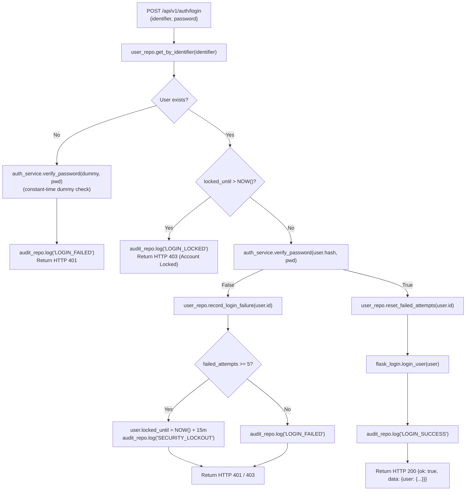

# StockTrade v2 — Business Logic & Execution Traces

This document details the exact business rules, mathematical formulas, and end-to-end execution paths enforced across StockTrade v2.

---

## 1. Authentication & Session Initialization Flow



- **Password Verification**: Werkzeug `check_password_hash` supports both PBKDF2:SHA256 (default) and scrypt.
- **Timing Attack Defense**: When an invalid username is submitted, a dummy hash computation is executed to equalize response duration.
- **Brute Force Lockout**: 5 failed login attempts trigger an immediate 15-minute lock. Reattempting before expiration returns HTTP 403.

---

## 2. Market Simulation & Pricing Mathematics

The market simulation engine runs in an autonomous background thread within the single Gunicorn worker process:

### Mathematical Formula: Stochastic Random Walk (Geometric Brownian Motion with Mean Reversion)

Every 500 milliseconds (0.50s), each listed equity $i$ undergoes an independent price tick:

$$\Delta P_i = P_{i,t} \times \left( \mu_i \cdot \Delta t + \sigma_{sector} \cdot \sqrt{\Delta t} \cdot Z + \kappa \cdot (\bar{P}_{sector} - P_{i,t}) \cdot \Delta t \right)$$

Where:
- $P_{i,t}$ is the current price of stock $i$.
- $\Delta t = 0.50$ seconds (tick interval).
- $\sigma_{sector}$ is the calibrated sector volatility multiplier (e.g. IT = 0.015, Banking = 0.012, FMCG = 0.008, Pharmaceuticals = 0.011).
- $Z \sim \mathcal{N}(0, 1)$ is a standard Gaussian random variable drawn from an independent deterministic pseudo-random generator `random.Random(seed + stock_id * 1009)`.
- $\kappa$ is the mean-reversion drift pull preventing runaway asset deflation or inflation.

### Circuit Limit Safeguards
- **Maximum Per-Tick Movement**: Clamped to $\pm 0.50\%$ of current price (`MAX_TICK_PCT = 0.005`).
- **Exchange Daily Circuit Breakers**: Bounded to $\pm 10.0\%$ from the prior close (`CIRCUIT_LIMIT_PCT = 0.10`):
  $$P_{min} = P_{prev\_close} \times 0.90, \quad P_{max} = P_{prev\_close} \times 1.10$$
  If $\Delta P_i$ breaches $P_{min}$ or $P_{max}$, the price is clamped to the boundary and status flags a circuit freeze.

### Decoupled Persistence
- The tick thread modifies only the in-memory dictionary `_stocks[stock_id]`.
- A dedicated flush worker wakes every 1.0 second, acquires `_cache_lock`, snapshots changed prices, and executes a batch `UPDATE Current_Prices` and batch `INSERT Stock_Prices` under MySQL advisory lock `GET_LOCK('stocktrade_simulator')`.

---

## 3. Atomic Buy Order Execution Flow

When an investor submits an order to buy $Q$ shares of stock $S$:

1. **API Validation (`routes/investor.py`)**:
   - Verify authenticated user role is `INVESTOR`.
   - Verify $Q > 0$ and $Q \in \mathbb{Z}^+$.
   - Verify `idempotency_key` is present (UUID v4).
2. **Procedure Execution (`sp_execute_trade`)**:
   - **Idempotency Replay Check**:
     ```sql
     SELECT id, status, executed_price FROM Orders WHERE user_id = p_user_id AND idempotency_key = p_idempotency_key;
     ```
     If found, return existing receipt immediately without mutating balances.
   - **Row Locking**:
     ```sql
     SELECT id, virtual_balance, status FROM Accounts WHERE user_id = p_user_id FOR UPDATE;
     SELECT id, quantity, avg_cost FROM Holdings WHERE user_id = p_user_id AND stock_id = p_stock_id FOR UPDATE;
     SELECT price, status FROM Current_Prices cp JOIN Stocks s ON cp.stock_id = s.id WHERE s.id = p_stock_id FOR UPDATE;
     ```
   - **Brokerage Fee Calculation**:
     $$\text{Gross Amount} = Q \times P_{curr}$$
     $$\text{Brokerage Fee} = \max(\text{Gross Amount} \times 0.0010, \text{₹}1.00)$$
     $$\text{Required Cash} = \text{Gross Amount} + \text{Brokerage Fee}$$
   - **Balance Verification**:
     $$\text{virtual\_balance} \ge \text{Required Cash}$$
     If insufficient, set `status = 'REJECTED'`, insert into `Orders` (`REJECTED`), and return `Insufficient funds`.
   - **Balance Deduction**:
     $$\text{virtual\_balance}_{new} = \text{virtual\_balance}_{old} - \text{Required Cash}$$
     ```sql
     UPDATE Accounts SET virtual_balance = v_balance_after WHERE id = v_account_id;
     ```
   - **Weighted-Average Cost (WAC) Basis Calculation**:
     $$\text{New Quantity} = Q_{old} + Q$$
     $$\text{New Avg Cost} = \frac{(Q_{old} \times \text{Avg Cost}_{old}) + (Q \times P_{curr})}{Q_{old} + Q}$$
     ```sql
     INSERT INTO Holdings (user_id, stock_id, quantity, avg_cost)
     VALUES (p_user_id, p_stock_id, p_quantity, v_curr_price)
     ON DUPLICATE KEY UPDATE 
         quantity = quantity + p_quantity,
         avg_cost = v_new_avg_cost;
     ```
   - **Double-Entry Ledger Entries (`Account_Ledger`)**:
     1. Trade row: `entry_type = 'BUY'`, `amount = -Gross Amount`, `balance_after = balance_before - Gross Amount`.
     2. Fee row: `entry_type = 'FEE'`, `amount = -Brokerage Fee`, `balance_after = balance_before - Required Cash`.
   - **Order and Transaction Logging**:
     - Insert into `Orders` (`status = 'EXECUTED'`).
     - Insert into `Transactions` (`gross_amount`, `brokerage_fee`, `net_amount = gross + fee`, `realized_pnl = 0.00`).
     - Trigger `trg_orders_audit_insert` automatically writes to `Order_Events`.

---

## 4. Atomic Sell Order Execution Flow

When an investor submits an order to sell $Q$ shares of stock $S$:

1. **Holding Sufficiency Verification**:
   - `SELECT quantity, avg_cost FROM Holdings ... FOR UPDATE`
   - Verify $Q_{holding} \ge Q$. If $Q_{holding} < Q$, reject with `Insufficient share holdings`.
2. **Gross & Settlement Calculation**:
   $$\text{Gross Amount} = Q \times P_{curr}$$
   $$\text{Brokerage Fee} = \max(\text{Gross Amount} \times 0.0010, \text{₹}1.00)$$
   $$\text{Net Proceeds Credited} = \text{Gross Amount} - \text{Brokerage Fee}$$
3. **Realized Profit / Loss (P&L) Calculation**:
   $$\text{Realized P\&L} = (\text{Execution Price} - \text{Avg Purchase Cost}) \times Q$$
4. **Holding Decrement**:
   - $Q_{new} = Q_{old} - Q$.
   - Avg cost basis remains unchanged on partial sells (FIFO/WAC standard).
   - If $Q_{new} = 0$, avg cost is reset to 0.0000.
5. **Cash Crediting & Ledger Entries**:
   - Cash incremented: `virtual_balance = virtual_balance + Net Proceeds`.
   - Ledger Entry 1: `entry_type = 'SELL'`, `amount = +Gross Amount`.
   - Ledger Entry 2: `entry_type = 'FEE'`, `amount = -Brokerage Fee`.
6. **Transaction Record**:
   - Insert into `Transactions` with computed `realized_pnl`.

---

## 5. Broker Commission Attribution Flow

StockTrade implements a platform-funded institutional commission model:
- **Brokerage Fee Collected**: Paid by the investor (e.g. ₹50.00).
- **Platform Split**: Platform transfers 40% of the brokerage fee to the assigned broker:
  $$\text{Commission Amount} = \text{Brokerage Fee} \times 0.40$$
- **Assignment Lookup**:
  ```sql
  SELECT broker_id FROM Broker_Clients WHERE investor_id = p_user_id AND status = 'ACTIVE' LIMIT 1;
  ```
- If an active broker is assigned, insert into `Commissions`:
  - `transaction_id`: 1:1 with executed transaction.
  - `broker_id`, `investor_id`.
  - `base_brokerage`: ₹50.00.
  - `rate_applied`: 0.40000.
  - `commission_amount`: ₹20.00.
- **Reporting Only**: Platform commissions represent earnings reports and do not artificially inflate or distort client cash ledgers.

---

## 6. AI SQL Assistant Intent Resolution & Execution Trace

```
User Prompt: "Show me all banking stocks"
     │
     ▼
[Step 1: IntentService.resolve_intent]
     • Dynamic Entity Registry: Checks cached/database tickers and sectors
     • Synonym Match: "banking" stems to canonical sector "Banking"
     • Scope Analysis: "all" maps to Scope.ALL (limit = 500, no arbitrary LIMIT 10)
     • Role Boundary: INVESTOR permitted to query v_market_latest
     • Structured Intent: Domain=MARKET, Sector='Banking', Scope=ALL
     │
     ▼
[Step 2: LLM Router / RAG Injection]
     • Injects rag_knowledge/schema_documentation.md and rule:
       "If user asks about a sector, you MUST include WHERE sector = '...'"
     • Provider Attempts: Grok (xAI) -> Gemini -> OpenRouter
     │
     ▼
[Step 3: Verification & Fallback Guard]
     • LLM output parsed: SELECT symbol, company_name, current_price FROM v_market_latest WHERE sector = 'Banking'
     • SQLValidator (sqlglot): Single SELECT statement? Yes. Disallowed tables? None.
     • SemanticValidator: Matches sector 'Banking'? Yes. Arbitrary limit? No.
     • (If LLM had omitted WHERE sector = 'Banking', SemanticValidator automatically rejects and substitutes IntentService.generate_sql)
     │
     ▼
[Step 4: Scoped Execution (QueryExecutor)]
     • Connection checked out from _ai_engine (stocktrade_ai_ro)
     • SET SESSION TRANSACTION READ ONLY;
     • SET @current_user_id = 4;
     • SET max_execution_time = 5000;
     • Cursor executes approved SQL -> Fetches 8 banking stocks (HDFCBANK, ICICIBANK, SBIN...)
     • SET @current_user_id = NULL;
     │
     ▼
[Step 5: Grounded Summarization & Audit Log]
     • Grounded Analysis: "Found 8 active equities in the Banking sector. Top stock: HDFCBANK (₹1,642.50)..."
     • Logged to AI_Query_History: validation_status='VALID', execution_status='SUCCESS', duration_ms=18
     • HTTP 200 returned to frontend
```
