# StockTrade v2 — Module Dependency & Call Graph

This document details the software layering, import hierarchies, cross-module call chains, and circular dependency prevention strategies implemented across StockTrade v2.

---

## 1. Architectural Layering Model

The project enforces a strict unidirectional dependency hierarchy:

```
[Presentation Layer]      frontend/src/ (React UI)  &  templates/ (Jinja2)
          │
          ▼
[Routing Layer]           routes/*.py (Flask Blueprints)
          │
          ▼
[Service Layer]           services/*.py (Business Rules, Simulation, AI)
          │
          ▼
[Repository Layer]        repositories/*.py (Data Access Objects)
          │
          ▼
[Database Model Layer]    models/*.py (Engines, Pools, Core Table Schemas)
          │
          ▼
[Storage Engine Layer]    MySQL 8.0 (Tables, Views, Procedures, Triggers)
```

**Architectural Rule**: Upper layers may import from lower layers, but lower layers never import from upper layers. Repositories never import services or routes.

---

## 2. Blueprint-to-Service Mapping

| Blueprint Module | Service Dependencies | Repository Dependencies | Primary Database Operations |
| :--- | :--- | :--- | :--- |
| [`routes/auth.py`](file:///c:/Users/zades/OneDrive/Pictures/Desktop/DBMSPRJ/routes/auth.py) | `services.auth_service.AuthService` | `repositories.user_repo.UserRepository`<br>`repositories.audit_repo.AuditRepository` | Read `Users`; insert `Audit_Logs`; set Flask-Login session |
| [`routes/market.py`](file:///c:/Users/zades/OneDrive/Pictures/Desktop/DBMSPRJ/routes/market.py) | `services.market_simulator.MarketSimulator` | `repositories.stock_repo.StockRepository` | Query `v_market_latest`; query `Stock_Prices` / `Stock_Price_Hourly` |
| [`routes/investor.py`](file:///c:/Users/zades/OneDrive/Pictures/Desktop/DBMSPRJ/routes/investor.py) | `services.trading_service.TradingService`<br>`services.portfolio_service.PortfolioService` | `repositories.account_repo.AccountRepository`<br>`repositories.holding_repo.HoldingRepository`<br>`repositories.watchlist_repo.WatchlistRepository`<br>`repositories.alert_repo.AlertRepository` | `CALL sp_execute_trade`; read `v_investor_portfolio`; CRUD `Watchlist`, `Price_Alerts` |
| [`routes/broker.py`](file:///c:/Users/zades/OneDrive/Pictures/Desktop/DBMSPRJ/routes/broker.py) | None (delegates directly to repository logic) | `repositories.broker_repo.BrokerRepository`<br>`repositories.user_repo.UserRepository` | Read `v_broker_client_summary`, `v_broker_commissions`; insert `Broker_Clients` |
| [`routes/admin.py`](file:///c:/Users/zades/OneDrive/Pictures/Desktop/DBMSPRJ/routes/admin.py) | `services.market_simulator.MarketSimulator`<br>`services.reconciliation_service.ReconciliationService` | `repositories.user_repo.UserRepository`<br>`repositories.stock_repo.StockRepository`<br>`repositories.audit_repo.AuditRepository` | CRUD `Stocks`; update `Users.status` / `locked_until`; read `v_admin_audit_logs`; `CALL sp_reconcile` |
| [`routes/ai.py`](file:///c:/Users/zades/OneDrive/Pictures/Desktop/DBMSPRJ/routes/ai.py) | `services.intent_service.IntentService`<br>`services.llm_router.LLMRouter`<br>`services.rag_service.RAGService`<br>`services.sql_validator.SQLValidator`<br>`services.semantic_validator.SemanticValidator`<br>`services.query_executor.QueryExecutor` | None (queries executed dynamically under `stocktrade_ai_ro`) | Execute read-only SELECT against 9 views; insert into `AI_Query_History` |
| [`routes/reports.py`](file:///c:/Users/zades/OneDrive/Pictures/Desktop/DBMSPRJ/routes/reports.py) | None | `repositories.transaction_repo.TransactionRepository`<br>`repositories.account_repo.AccountRepository` | Stream CSV lines with formula injection sanitization |

---

## 3. End-to-End Call Graph (Mermaid)

```mermaid
flowchart TD
    subgraph Blueprints["Routes / Blueprints"]
        AuthBP["routes.auth"]
        MarketBP["routes.market"]
        InvestorBP["routes.investor"]
        BrokerBP["routes.broker"]
        AdminBP["routes.admin"]
        AiBP["routes.ai"]
        ReportsBP["routes.reports"]
    end

    subgraph Services["Services & Orchestration"]
        AuthSvc["services.auth_service"]
        TradingSvc["services.trading_service"]
        SimSvc["services.market_simulator"]
        PortSvc["services.portfolio_service"]
        ReconSvc["services.reconciliation_service"]
        IntentSvc["services.intent_service"]
        RouterSvc["services.llm_router"]
        RagSvc["services.rag_service"]
        SemValSvc["services.semantic_validator"]
        AstValSvc["services.sql_validator"]
        QueryExec["services.query_executor"]
    end

    subgraph Repositories["Data Access Repositories"]
        UserRepo["repositories.user_repo"]
        StockRepo["repositories.stock_repo"]
        AcctRepo["repositories.account_repo"]
        HoldRepo["repositories.holding_repo"]
        OrderRepo["repositories.order_repo"]
        TransRepo["repositories.transaction_repo"]
        BrokRepo["repositories.broker_repo"]
        WatchRepo["repositories.watchlist_repo"]
        AlertRepo["repositories.alert_repo"]
        AuditRepo["repositories.audit_repo"]
        LedgRepo["repositories.ledger_repo"]
    end

    subgraph DatabaseLayer["Database Connection Layer"]
        DBMod["models.db<br>(_engine / _ai_engine)"]
    end

    AuthBP --> AuthSvc & UserRepo & AuditRepo
    MarketBP --> SimSvc & StockRepo
    InvestorBP --> TradingSvc & PortSvc & AcctRepo & HoldRepo & WatchRepo & AlertRepo
    BrokerBP --> BrokRepo & UserRepo
    AdminBP --> SimSvc & ReconSvc & UserRepo & StockRepo & AuditRepo
    AiBP --> IntentSvc & RouterSvc & RagSvc & SemValSvc & AstValSvc & QueryExec
    ReportsBP --> TransRepo & AcctRepo

    TradingSvc --> DBMod
    SimSvc --> DBMod
    ReconSvc --> DBMod
    QueryExec --> DBMod

    UserRepo & StockRepo & AcctRepo & HoldRepo & OrderRepo & TransRepo & BrokRepo & WatchRepo & AlertRepo & AuditRepo & LedgRepo --> DBMod
```



---

## 4. Circular Dependency Prevention Strategies

1. **Lazy Imports Inside Factory**:
   In [`app.py`](file:///c:/Users/zades/OneDrive/Pictures/Desktop/DBMSPRJ/app.py), blueprints are imported inside `create_app()` after extensions and database connection pools are initialized. This prevents circular imports between blueprints and the Flask application instance.
2. **Context Managers for Connections**:
   Modules never hold persistent global connection references. Connections are acquired on demand via `get_db_connection()`, `get_db_transaction()`, or `get_ai_connection()` inside scoped `with` blocks.
3. **Singleton Thread Management**:
   The `MarketSimulator` class uses a private class lock `_singleton_lock` in `get_instance()`. Worker threads are spawned only when explicitly started in `wsgi.py` or `start.ps1`.
