# StockTrade Entity-Relationship Diagram (ERD.md)

This document visualizes the complete relational architecture of **StockTrade**, mapped to strict 3NF with documented denormalization, Foreign Key constraints (`ON DELETE RESTRICT`), and decimal precision types.

---

## Mermaid Entity-Relationship Diagram

```mermaid
erDiagram
    Users ||--o| Accounts : "1:1 owns account"
    Users ||--o{ Orders : "1:N places orders"
    Users ||--o{ Holdings : "1:N holds stock positions"
    Users ||--o{ Transactions : "1:N executes trades"
    Users ||--o{ Watchlist : "M:N watches stocks"
    Users ||--o{ Price_Alerts : "1:N configures alerts"
    Users ||--o{ Broker_Clients : "M:N broker-investor assignment"
    Users ||--o{ AI_Query_History : "1:N queries AI assistant"
    Users ||--o{ Saved_Reports : "1:N saves custom SQL reports"
    Users ||--o{ Portfolio_Snapshots : "1:N historical performance"
    
    Accounts ||--o{ Account_Ledger : "1:N append-only journal entries"
    
    Stocks ||--|| Current_Prices : "1:1 cached live market quote"
    Stocks ||--o{ Stock_Prices : "1:N 1-minute historical observations"
    Stocks ||--o{ Stock_Price_Hourly : "1:N aggregated hourly rollups"
    Stocks ||--o{ Orders : "1:N targeted in orders"
    Stocks ||--o{ Holdings : "1:N held in portfolios"
    Stocks ||--o{ Transactions : "1:N traded in transactions"
    Stocks ||--o{ Watchlist : "M:N bookmarked in watchlists"
    Stocks ||--o{ Price_Alerts : "1:N monitored for price triggers"
    
    Orders ||--o| Transactions : "1:1 executed trade record"
    Orders ||--o{ Order_Events : "1:N lifecycle audit trail"
    
    Transactions ||--o| Commissions : "1:1 broker commission record"

    Users {
        BIGINT id PK
        VARCHAR username UK
        VARCHAR email UK
        VARCHAR password_hash
        VARCHAR full_name
        VARCHAR phone
        ENUM role "ADMIN, BROKER, INVESTOR"
        ENUM status "ACTIVE, INACTIVE"
        BOOLEAN is_demo
        INT failed_login_attempts
        TIMESTAMP locked_until
        TIMESTAMP last_login_at
        TIMESTAMP created_at
    }

    Accounts {
        BIGINT id PK
        BIGINT user_id FK,UK
        DECIMAL virtual_balance "15,2 CHECK >= 0"
        VARCHAR currency "INR"
        ENUM status "ACTIVE, INACTIVE"
        TIMESTAMP created_at
    }

    Stocks {
        BIGINT id PK
        VARCHAR symbol UK
        VARCHAR company_name
        VARCHAR sector
        ENUM exchange "NSE, BSE"
        ENUM status "ACTIVE, INACTIVE"
        TIMESTAMP created_at
    }

    Current_Prices {
        BIGINT stock_id PK,FK
        DECIMAL price "12,4"
        DECIMAL previous_close "12,4"
        DECIMAL day_open "12,4"
        DECIMAL day_high "12,4"
        DECIMAL day_low "12,4"
        BIGINT volume
        TIMESTAMP updated_at
    }

    Stock_Prices {
        BIGINT id PK
        BIGINT stock_id FK
        DECIMAL price "12,4"
        INT volume
        ENUM source "SEEDED, SIMULATED"
        TIMESTAMP recorded_at
    }

    Orders {
        BIGINT id PK
        BIGINT user_id FK
        BIGINT stock_id FK
        ENUM side "BUY, SELL"
        INT quantity "CHECK > 0"
        DECIMAL estimated_price "12,4"
        DECIMAL executed_price "12,4"
        ENUM status "PENDING, EXECUTED, REJECTED, FAILED"
        VARCHAR reject_reason
        VARCHAR idempotency_key "UK(user_id, idempotency_key)"
        TIMESTAMP created_at
        TIMESTAMP executed_at
    }

    Holdings {
        BIGINT id PK
        BIGINT user_id FK
        BIGINT stock_id FK
        INT quantity "CHECK >= 0"
        DECIMAL avg_cost "12,4"
        TIMESTAMP updated_at
    }

    Transactions {
        BIGINT id PK
        BIGINT order_id FK,UK
        BIGINT user_id FK
        BIGINT stock_id FK
        ENUM side "BUY, SELL"
        INT quantity
        DECIMAL execution_price "12,4"
        DECIMAL gross_amount "15,2"
        DECIMAL brokerage_fee "15,2"
        DECIMAL net_amount "15,2"
        DECIMAL realized_pnl "15,2"
        TIMESTAMP executed_at
    }

    Account_Ledger {
        BIGINT id PK
        BIGINT account_id FK
        ENUM entry_type "OPENING_GRANT, DEPOSIT, BUY, SELL, FEE, ADJUSTMENT"
        DECIMAL amount "15,2"
        DECIMAL balance_after "15,2"
        VARCHAR reference_type
        VARCHAR reference_id
        VARCHAR note
        TIMESTAMP created_at
    }

    Broker_Clients {
        BIGINT id PK
        BIGINT broker_id FK
        BIGINT investor_id FK
        ENUM status "ACTIVE, ENDED"
        TIMESTAMP assigned_at
        TIMESTAMP ended_at
    }

    Commission_Rules {
        INT id PK
        ENUM rule_type "INVESTOR_BROKERAGE, BROKER_COMMISSION"
        DECIMAL rate "6,5"
        DECIMAL min_fee "15,2"
        TIMESTAMP effective_from
        BOOLEAN is_active
    }

    Order_Events {
        BIGINT id PK
        BIGINT order_id FK
        VARCHAR from_status
        VARCHAR to_status
        VARCHAR reason
        TIMESTAMP event_timestamp
    }

    Commissions {
        BIGINT id PK
        BIGINT transaction_id FK,UK
        BIGINT broker_id FK
        BIGINT investor_id FK
        DECIMAL base_brokerage "15,2"
        DECIMAL rate_applied "6,5"
        DECIMAL commission_amount "15,2"
        TIMESTAMP created_at
    }
```

