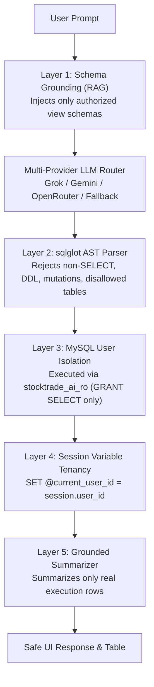

# StockTrade Security Architecture & Defense-in-Depth

StockTrade implements fintech-grade defensive controls across authentication, financial data integrity, tenant isolation, export sanitization, and autonomous AI code execution.

---

## 1. Five-Layer AI-to-SQL Security Pipeline

The AI-to-SQL Assistant allows natural language queries over the database without exposing the database to SQL injection, privilege escalation, or cross-tenant data leakage.

### Layer Details:
1. **Schema Grounding (RAG)**: The prompt context includes only safe database views authorized for the caller's role (`v_investor_portfolio`, `v_broker_client_summary`, `v_admin_trade_facts`). Raw physical tables (`Users`, `Accounts`, `Orders`, etc.) are never disclosed to the LLM.
2. **sqlglot AST Validator**:
   - Parses the generated SQL into an Abstract Syntax Tree using the MySQL dialect.
   - Strictly enforces single-statement read queries (`exp.Select` or `exp.Union`).
   - Rejects any AST node matching `exp.Insert`, `exp.Update`, `exp.Delete`, `exp.Drop`, `exp.Alter`, `exp.Create`.
   - Checks table references against role-specific allowlists (`ROLE_ALLOWED_TABLES`).
   - Prohibits dangerous functions (`sleep`, `benchmark`, `load_file`, `sys_eval`, `into outfile`).
3. **Database User Isolation**: Queries are executed using a dedicated MySQL user `stocktrade_ai_ro` which possesses only `SELECT` privileges on views. Even if a parser flaw existed, the database engine forbids writes.
4. **Session-Level Tenancy Scoping**: Before executing the query, the connection sets `SET @current_user_id = :user_id`. Views join against `@current_user_id`, preventing users from crafting prompts to exfiltrate other users' data.
5. **Grounded Summarizer**: If a query returns 0 rows, the assistant explicitly states that no records match, preventing hallucinated balances or metrics.

---

## 2. Authentication, RBAC & Session Security

- **Password Hashing**: Werkzeug `scrypt` hashing with unique salt per user. Passwords are never stored in plaintext.
- **Brute-Force Lockout**: Tracks consecutive failed login attempts in `Users.failed_login_attempts`. Upon 5 failed attempts, `Users.locked_until` is set to `CURRENT_TIMESTAMP + 15 MINUTES`.
- **Session Rotation**: On successful authentication, `session.clear()` is called to prevent session fixation attacks.
- **Role-Based Access Control (RBAC)**: Enforced via the `@role_required("ROLE")` decorator on endpoints and object-level checks in repository layers. Identity is derived strictly from `current_user.id` in server-side session, never from client-provided query parameters.
- **Tenant Isolation (404 Not Found Policy)**: When a broker attempts to access an investor who is not assigned to them, the system returns `404 Not Found` rather than `403 Forbidden`. This eliminates user enumeration vulnerabilities.

---

## 3. Financial Immutability & Concurrency Safety

- **Append-Only Financial Ledger**: The `Account_Ledger` table is protected by MySQL triggers `trg_ledger_block_update` and `trg_ledger_block_delete`. Any attempt to update or delete a ledger row raises a `SIGNAL SQLSTATE '45000'` exception.
- **Deterministic Row-Locking Order**: `sp_execute_trade` locks rows in a fixed physical sequence:
  1. `Accounts` (locks investor balance via `FOR UPDATE`)
  2. `Holdings` (locks existing position via `FOR UPDATE`)
  3. `Current_Prices` (locks price row via `FOR SHARE`)
  This guarantees deadlock-free execution under 20+ simultaneous threads.
- **Double Reconciliation Invariant**: After any trade, the system verifies:
  $$\text{Accounts.virtual\_balance} = \sum \text{Ledger Signed Amounts}$$
  $$\text{Holdings.quantity} = \sum \text{Executed Buys} - \sum \text{Executed Sells}$$
- **Distributed Advisory Lock**: The market simulator background worker uses MySQL's `SELECT GET_LOCK('stocktrade_simulator_lock', 0)` to guarantee exactly one active simulator instance across multi-threaded or multi-worker deployments.

---

## 4. Export & Injection Hardening

- **CSV Formula Injection (DDE) Sanitization**: When exporting transaction history to CSV, all cell values are inspected. Any string beginning with `=`, `+`, `-`, `@`, `\t`, or `\r` is automatically prepended with a single quote (`'`), neutralizing executable Excel formula exploits.
- **CSRF Protection**: All state-changing POST/PUT/DELETE requests require a valid CSRF token verified by `Flask-WTF`. Tokens are also sent in response headers (`X-CSRFToken`) for seamless SPA consumption.
- **Security Headers**: Every HTTP response includes:
  - `X-Content-Type-Options: nosniff`
  - `X-Frame-Options: SAMEORIGIN`
  - `X-XSS-Protection: 1; mode=block`
  - `Referrer-Policy: strict-origin-when-cross-origin`
